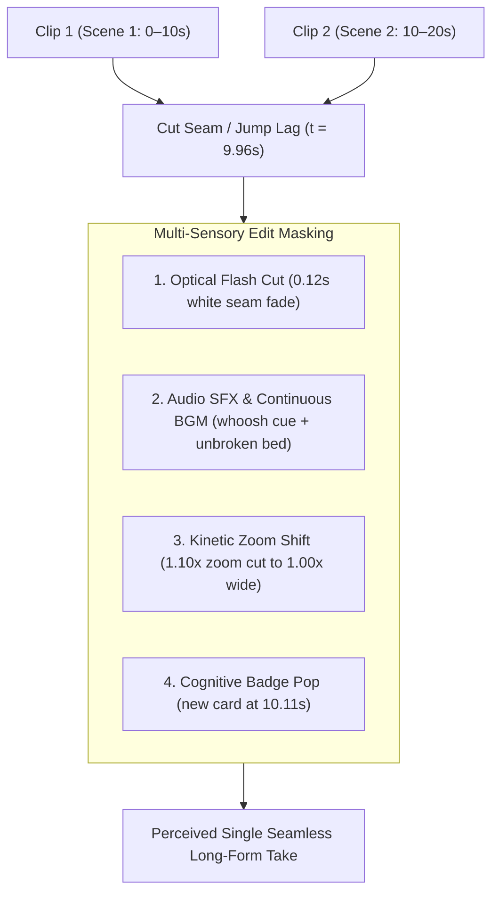

# Masking Generative Seam Lag in Multi-Clip UGC Videos

## Multi-Sensory Masking Architecture

| Challenge / Seam Symptom | Editing Counter-Mechanism | Sensory Dimension | Observed Production Outcome |
|---|---|---|---|
| **Pose Discontinuity** | Optical micro-flash (`color=white:d=0.12s`) placed strictly at the cut seam. | Visual / Optical | Overrides retinal persistence; viewer perceives deliberate camera transition rather than avatar glitch. |
| **Motion Freeze / Jump Lag** | Immediate focal change via punch zoom reset (`1.10x` punch → `1.00x` wide framing). | Spatial / Framing | Recontextualizes subject position as intentional cinematic angle cut rather than temporal hiccup. |
| **Audio Severance** | Continuous unbroken BGM bed (-21dB) + loudnorm speech (-16 LUFS) crossing seam. | Acoustic / Flow | Brain uses continuous acoustic frequency bed to bridge visual cuts into single narrative stream. |
| **Gaze Fixation on Seam** | Timed sound effect (`whoosh.mp3`) paired with new card pop (`10.11s`). | Cognitive / Attention | Forces immediate saccadic eye movement toward incoming typography, pulling gaze away from seam. |

## The Four Synchronization Layers

| Layer | Precise Timing at Seam | Asset / Filter Specification | Psychoacoustic & Visual Function |
|---|---|---|---|
| **1. Optical Seam Flash** | `t = 9.96s` (0.00s–0.12s of Clip 2) | Segment sub-filter `fade=t=in:st=0:d=0.12:color=white` | Creates a brief high-luminance burst that covers avatar hand and head realignment. |
| **2. Dynamic Zoom Cut** | `t = 9.96s` (exact seam moment) | Segment 2 `zoom=1.10` → Segment 3 `zoom=1.00` | Abrupt scale shift mimics multi-camera switching, making jump cuts feel professional. |
| **3. Acoustic Momentum** | `t = 9.96s` ± 0.05s | `whoosh.mp3` cue at `vol=0.55` over continuous music bed | Provides acoustic justification for visual transition; primes listener for next topic. |
| **4. Cognitive Re-Anchoring** | `t = 10.11s` (+0.15s post-seam) | New ASS card display + `pop.mp3` (`vol=0.45`) | Re-anchors viewer cognitive attention to new textual value proposition instantly. |

## Cognitive & Psychoacoustic Mechanisms

| Mechanism | Operating Principle | Why Raw Stitch Fails | Why Multi-Sensory Edit Succeeds |
|---|---|---|---|
| **Saccadic Suppression** | Brief flash cuts trigger visual saccades, during which retinal intake is suppressed for ~50ms. | Raw generative cut exposes jump lag directly to viewer foveal vision. | The optical pulse conceals the physical cut during the transient suppression window. |
| **Acoustic Continuity Bias** | Auditory cortex interprets scenes sharing an unbroken audio bed as temporally continuous. | Disconnected or unmastered audio highlights video gaps. | Unbroken music bed tricks brain into perceiving continuous scene duration. |
| **Attention Re-Direction** | In-stream typography and directional SFX redirect focus away from background artifacts. | Static camera leaves viewer scanning presenter posture and hand micro-jitters. | Dynamic bounce captions and badge cards capture focal attention completely. |
| **Cinematic Expectation Framing** | Punch zooms convert unexpected temporal discontinuities into expected cinematic grammar. | Small position shifts appear as rendering defects or dropped video frames. | Large intentional framing changes match established YouTube/TikTok pacing conventions. |

## Implementation Filtergraph Recipe

| Step | Technical Implementation | Code / Filter Pattern | Critical Guardrail |
|---|---|---|---|
| **1. Isolate Scene Flash** | Place fade inside segment trim chain, never on global master bus. | `[0:v]trim=9.96:13.65,setpts=PTS-STARTPTS,fade=t=in:st=0:d=0.12:color=white[v_pz_3]` | Avoid global `fade=in` at start of video which causes solid white opening screens. |
| **2. Cut Framing Shift** | Alter crop dimensions across segment boundary to create angle cut. | Segment N: `zoom=1.10:y_focus=0.55` → Segment N+1: `zoom=1.00:y_focus=0.50` | Ensure width and height maintain exact 720×1280 portrait pixel dimensions. |
| **3. Sync Acoustic Cue** | Align SFX whoosh exactly with seam timestamp. | `sfx_events: [{"time": 9.96, "file": "whoosh.mp3", "volume": 0.55}]` | Misaligned SFX (>0.15s off) creates perceptual dissonance and accentuates the jump. |
| **4. Delay Badge Re-anchor** | Trigger incoming badge card 100–150ms after seam cut. | `badges: [{"text": "...", "start": 10.11, "end": 13.36}]` | Immediate t=9.96s badge collides with flash; 150ms delay creates clean arrival. |
