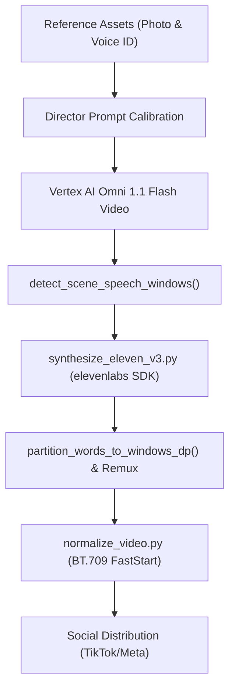
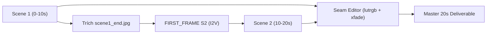

# Avatar-Based UGC Video Synthesis Workflow

| Nguyên lý cốt lõi | Yêu cầu kỹ thuật mô phỏng người thật (Human Mimicry) | Căn cứ kinh nghiệm từ `ugc-video` |
| --- | --- | --- |
| **Thực thi tức thì (Turn-1 Render Gate)** | Khi người dùng yêu cầu tạo hoặc clone video, **bắt buộc chạy [`engine.py`](file:///Users/thevinhnguyen/Documents/computer-science/projects/social-content/projects/ugc-video/scripts/new_system/engine.py) (tự động dùng `.venv/bin/python`) xuất ra file `.mp4` ngay trong lượt phản hồi đầu tiên**; tuyệt đối không dừng lại ở việc viết file JSON hay trình bày kế hoạch. | Tránh lỗi chỉ sinh file cấu hình mà không tạo sản phẩm video thực tế. |
| **Chân thực thị giác & Creator Slug** | Khai báo `"creator": "<slug>"` (`"diep"` hoặc `"ngat"`) trong JSON để [`engine.py`](file:///Users/thevinhnguyen/Documents/computer-science/projects/social-content/projects/ugc-video/scripts/new_system/engine.py) tự động nạp [`face.jpg`](file:///Users/thevinhnguyen/Documents/computer-science/projects/social-content/projects/ugc-video/assets/images/ngat/face.jpg) (`<IMAGE_REF_0>`), [`clothes.jpg`](file:///Users/thevinhnguyen/Documents/computer-science/projects/social-content/projects/ugc-video/assets/images/ngat/clothes.jpg) (`<IMAGE_REF_1>`), và `voice_id` từ `assets/audio/<slug>/voice_meta.json`. | Không cần tìm kiếm thủ công Voice ID hay đường dẫn ảnh của từng nhân vật. |
| **Dáng vẻ & Tương tác vật lý** | Góc máy nhìn nghiêng 35° (xưởng sản xuất) hoặc eye-level selfie POV (chia sẻ cá nhân), rung lắc tự nhiên của máy quay cầm tay. | Tạo cảm giác video đời thực thay vì người mẫu studio tĩnh. |
| **Khử sạch Watermark & Lọc An Toàn** | Cấm từ khóa mạng xã hội (`TikTok`, `Instagram`, `Reels`) trong visual prompt. Giữ lời thoại gửi cho Gemini Omni giống hệt `clauses` của ElevenLabs (tránh từ nhạy cảm như `"kẻ ngoại tình"` bằng từ trung tính như `"người phản bội"`); chỉ dùng `safe_fallback` khi Vertex AI trả lỗi `400 safety violations`. | Đảm bảo khẩu hình (visemes) và nhịp ngắt nghỉ giữa video với TTS khớp 1:1, đồng thời triệt tiêu ảo giác logo `@documentars`. |
| **Âm thanh & Khẩu hình** | [`engine.py`](file:///Users/thevinhnguyen/Documents/computer-science/projects/social-content/projects/ugc-video/scripts/new_system/engine.py) gọi [`synthesize_eleven_v3.py`](file:///Users/thevinhnguyen/Documents/computer-science/projects/social-content/projects/ugc-video/scripts/new_system/synthesize_eleven_v3.py) (`elevenlabs` Python SDK `client.text_to_speech.convert_with_timestamps`, `model_id="eleven_v3"`, `output_format="mp3_44100_128"`), trích từ bằng `extract_scene_words()` và phân hoạch theo quy hoạch động (`partition_words_to_windows_dp()`) khớp chính xác vào các khoảng mở miệng (`detect_scene_speech_windows()`), tuyệt đối không phát tiếng trong khoảng ngậm miệng. | Tránh lỗi HTTP 403 (`mp3_44100_192`), tránh nói đè qua khoảng ngậm miệng giữa câu và tránh méo tiếng `atempo=2.0x`. |
| **Quy chuẩn mã hóa social** | [`engine.py`](file:///Users/thevinhnguyen/Documents/computer-science/projects/social-content/projects/ugc-video/scripts/new_system/engine.py) tự động gọi [`normalize_video.py`](file:///Users/thevinhnguyen/Documents/computer-science/projects/social-content/projects/ugc-video/scripts/new_system/normalize_video.py) chuẩn hóa BT.709, AAC stereo 44.1kHz, GOP 48, và FastStart. | Ngăn chặn triệt để lỗi pixel vỡ hồng/tím trên Instagram/Facebook. |

| Creator Slug (`"creator"`) | Ảnh tham chiếu tự động | Voice ID tự động (`voice_meta.json`) | Phong cách & Bối cảnh mặc định |
| --- | --- | --- | --- |
| **`"diep"`** | `assets/images/diep/{face,clothes}.jpg` | `FXJGVNPXC71BGT9PjlMX` | Chủ xưởng in giấy mỹ thuật, góc máy 35° POV bên bàn xưởng. |
| **`"ngat"`** | `assets/images/ngat/{face,clothes}.jpg` | `a95xm5oG7Gvnxoyv5jeJ` | Chị Ngát (Bùi Thị Ngát), góc máy selfie trực diện trong phòng ấm cúng. |

| Giai đoạn (End-to-End 3 Bước) | Mục tiêu | Lệnh thực thi chuẩn duy nhất (Từ thư mục gốc repo, dùng `.venv/bin/python`) | Sản phẩm đầu ra (Artifacts) |
| --- | --- | --- | --- |
| **1. Phân tích & Bóc tách Reel gốc** | Tải video mẫu, tách âm thanh 16kHz và chép lời + đề xuất kịch bản 2 cảnh bằng `gemini-3.8-flash` | `.venv/bin/python projects/ugc-video/scripts/new_system/engine.py --analyze-reel "<REEL_URL_OR_MP4>"` | Bản chép lời, cấu trúc Hook/Body/Kết và gợi ý thoại (18–24 từ/cảnh). |
| **2. Khai báo JSON & Render Video** | Sinh toàn bộ các cảnh 10s trên `gemini-omni-1.1-flash-preview`, ghép nối `<FIRST_FRAME>`, gọi [`synthesize_eleven_v3.py`](file:///Users/thevinhnguyen/Documents/computer-science/projects/social-content/projects/ugc-video/scripts/new_system/synthesize_eleven_v3.py), căn chỉnh DP `partition_words_to_windows_dp` và chuẩn hóa BT.709 | Tạo `projects/ugc-video/scripts/new_system/configs/<slug>.json` rồi chạy ngay: `.venv/bin/python projects/ugc-video/scripts/new_system/engine.py projects/ugc-video/scripts/new_system/configs/<slug>.json` | File video hoàn chỉnh `renders/<slug>/<slug>_web_optimized.mp4` + `clause_bounds.json`. |
| **3. Hậu kỳ Subtitles & SFX (Tùy chọn)** | Đóng phụ đề karaoke từng từ, banner hook, zoom động và nhạc nền | `.venv/bin/python projects/ugc-video/scripts/new_system/effect_editor.py projects/ugc-video/scripts/new_system/configs/<slug>_effects.json` | Video hậu kỳ `renders/<slug>/<slug>_engaged_effect.mp4`. |

| Thẻ chỉ thị | Quy chuẩn nội dung prompt | Mục đích điều hướng mô hình |
| --- | --- | --- |
| **`[CAMERA & COMPOSITION]`** | `Vertical 9:16 mobile POV. High-angle perspective (35-degree downward tilt) filmed beside workshop workbench, looking down across the table. Natural handheld camera breathing and motion tracking presenter's hands, raw BTS workshop documentary style. Pristine clean video, absolutely no watermarks, no logos, no text overlays, no usernames.` | Ngăn AI mặc định sinh góc chụp thẳng đứng trung tâm kiểu studio; cấm từ "TikTok" để triệt tiêu ảo giác logo `@documentars`. |
| **`[ENVIRONMENT & ATMOSPHERE]`** | `Active industrial paper workshop (xưởng in). Background: commercial guillotine cutter, stacked paper reams on pallets under overhead fluorescent lighting. On workbench: sample paper sheets and carton boxes.` | Loại bỏ phông nền phòng ngủ, phòng khách hoặc bàn văn phòng giả tạo; gán bối cảnh xưởng sản xuất thật. |
| **`[SUBJECT & APPEARANCE]`** | `Young East Asian female artisan matching <IMAGE_REF_0> wearing the casual outfit in <IMAGE_REF_1>. Standing beside workbench, leaning forward naturally, engaging warmly with camera.` | Neo chặt chẽ tỷ lệ gương mặt và phục trang theo ảnh thực tế; nhân vật có tư thế hơi cúi vào bàn làm việc. |
| **`[ACTION & TIMECODE]`** | • `00:00 - 00:03`: Thao tác mở gói/kiện hàng hoặc nhấc sản phẩm khoe trước ống kính. • `00:03 - 00:07`: Cận cảnh tay vuốt chất liệu, gập nếp, thử độ dai, nói chuyện say sưa. • `00:07 - 00:10`: Đặt sản phẩm ngay ngắn, nhìn thẳng camera cười tươi mời gọi liên hệ. | Phân chia tiến trình thời gian rõ ràng, đảm bảo hành động ăn khớp nhịp tâm lý người xem video ngắn. |
| **`[AUDIO & DIALOGUE]`** | Quoted verbatim Vietnamese sentence: `"..."` kèm ghi chú: `Lively spoken Vietnamese dialogue with artisan cadence matching recorded voice. Ambient print shop background sound.` | Ép mô hình sinh khẩu hình miệng phát âm tiếng Việt chuẩn xác thay vì khẩu hình tiếng Anh. |

| Vấn đề âm thanh | Nguyên nhân gốc rễ | Giải pháp chuẩn hóa bắt buộc |
| --- | --- | --- |
| **Giọng robot, ngữ điệu khô cứng** | Gemini Omni Flash chỉ tạo giọng đọc tổng hợp ngẫu nhiên theo prompt văn bản; không thể tự nhân bản giọng người thật. | Sử dụng trực tiếp Voice ID `FXJGVNPXC71BGT9PjlMX` (*Vietnamese Actual Women Voice*, `vi-northern`) trên ElevenLabs. |
| **Hai cảnh bị lệch giọng Bắc/Nam khi dùng STS** | Gemini Omni không có voice seed nên Scene 1 sinh giọng miền Nam (`vi-southern`) còn Scene 2 sinh giọng miền Bắc (`vi-northern`); đồng thời `eleven_multilingual_sts_v2` có `vi: false` (không hỗ trợ tiếng Việt) nên sao chép nguyên xi phương ngữ của audio dẫn và nói ngọng dấu thanh. | **Dùng [`synthesize_eleven_v3.py`](file:///Users/thevinhnguyen/Documents/computer-science/projects/social-content/projects/ugc-video/scripts/new_system/synthesize_eleven_v3.py) (`elevenlabs` Python SDK `client.text_to_speech.convert_with_timestamps`, `model_id="eleven_v3"`, `output_format="mp3_44100_128"`)**: Sinh 1 file TTS nguyên khối kèm mốc thời gian ký tự (`tts_v3_alignment.json`), sau đó dùng `partition_words_to_windows_dp` ánh xạ từng cụm từ khớp vào đúng các cửa sổ mở miệng (`detect_scene_speech_windows`). |
| **Tiếng nói phát đè qua lúc nhân vật ngậm miệng nghỉ giữa câu** | Chia tỷ lệ đơn thuần từ đầu đến cuối cảnh (`[span_start, span_end]`) hoặc truyền `visual_dialogue` khác với `clauses` khiến TTS đọc xuyên qua các khoảng lặng ngậm miệng (`0.4s–1.2s`) và lệch khẩu hình âm tiết. | Giữ `clauses` đồng nhất giữa Gemini Omni và ElevenLabs; dùng `extract_scene_words()` + `partition_words_to_windows_dp()` trong [`engine.py`](file:///Users/thevinhnguyen/Documents/computer-science/projects/social-content/projects/ugc-video/scripts/new_system/engine.py) để cắt cụm từ tại dấu câu (`.?!,;:`) khớp `1:1` vào từng cửa sổ `detect_scene_speech_windows()`, đảm bảo `0%` giọng đọc phát ra khi miệng đóng. |
| **Câu nói bị cắt cụt ở cuối cảnh 1 (`9.7s`)** | Trong `scene1_raw.mp4`, AI tự bắt đầu đọc sớm câu của Scene 2 (`"Khổ ti-"`) ở giây `9.7s` rồi bị cắt ngang tại `10.0s`, gây lặp từ `"Khổ ti- / Khổ tiêu chuẩn"` khi ghép. | `detect_scene_speech_windows()` tự động loại bỏ các âm tiết mồi xuất hiện trong `0.65s` cuối của các cảnh không phải cảnh cuối. |
| **Lỗi API 400 khi truyền audio vào Omni** | Model `gemini-omni-flash-preview` chỉ chấp nhận đầu vào multimodal là Văn bản và Hình ảnh; từ chối luồng âm thanh đầu vào. | Tách quy trình thành 2 bước độc lập: Gemini tạo hình ảnh + khung thời gian khẩu hình -> ElevenLabs `eleven_v3` `convertWithTimestamps` khớp thoại sau khi video hoàn thành. |
| **Mất đồng bộ do tần số mẫu** | Audio xuất ra có sample rate không đồng nhất với luồng AAC của mạng xã hội. | Ép tần số mẫu về chuẩn 44.1 kHz stereo AAC (`-ar 44100 -ac 2 -b:a 192k`) trong bước remux và transcode. |

| Lỗi thực tế gặp phải | Nguyên nhân mã hóa (Root Cause) | Cờ xử lý trong `normalize_video.sh` / Pipeline |
| --- | --- | --- |
| **Ảo giác logo TikTok (@documentars)** | Prompt chứa từ khóa mạng xã hội (`"authentic TikTok..."`), mô hình khuếch tán gán trọng số watermark từ dữ liệu crawl vào video. | **Phòng ngừa:** Cấm từ "TikTok" trong prompt, thêm cấm logo. **Khắc phục nguội:** `ffmpeg -vf "delogo=x=545:y=960:w=170:h=125,delogo=x=20:y=50:w=170:h=125"`. |
| **Vỡ mảng màu hồng/tím trên di động** | Xung đột VUI tag giữa không gian màu Rec.601 (`smpte170m`) và ma trận Rec.709 (`bt709`), khiến bộ giải mã phần cứng Meta tính sai ma trận màu. | `-vf "colorspace=all=bt709:trc=bt709:primaries=bt709"` |
| **Video tải chậm, không phát tức thì** | Header atom `moov` nằm ở cuối file (EOF), trình duyệt phải tải hết 100% dung lượng mới bắt đầu giải mã khung hình đầu tiên. | `-movflags +faststart` |
| **Giật lag khi người dùng tua video** | Khoảng cách khung khóa (GOP) của video AI quá lớn (166 frames ~ 7 giây mới có 1 I-frame), gây lỗi block artifact khi tua. | `-g 48 -keyint_min 48 -sc_threshold 0` (cố định 2.0s closed GOP tại 24 fps) |

| Bước kiểm tra | Lệnh xác minh | Tiêu chuẩn ĐẠT (Pass Criteria) |
| --- | --- | --- |
| **1. Kiểm tra không gian màu** | `ffprobe -v error -show_entries stream=color_space,color_primaries,color_transfer -of default=noprint_wrappers=1 <FILE>` | Cả 3 trường đều báo: `bt709`. Tuyệt đối không còn `smpte170m`. |
| **2. Kiểm tra luồng âm thanh** | `ffprobe -v error -select_streams a:0 -show_entries stream=sample_rate,channels,codec_name -of default=noprint_wrappers=1 <FILE>` | Báo: `codec_name=aac`, `sample_rate=44100`, `channels=2`. |
| **3. Kiểm tra vị trí header** | `ffprobe -v trace <FILE> 2>&1 \| grep -E "type:'moov'\|type:'mdat'"` | Atom `moov` phải xuất hiện trước atom `mdat` (FastStart active). |
| **4. Kiểm tra sạch Watermark** | Trích xuất khung hình tại giây 2, 5, 8; kiểm tra góc dưới-phải và trên-trái | Không có logo nốt nhạc TikTok, không có chữ `@documentars` hoặc bất kỳ watermark nào. |
| **5. Kiểm tra khẩu hình trực quan** | Xem video phát lại tại tốc độ 1.0x và 0.5x | Khẩu hình khớp từng âm tiết tiếng Việt; không méo răng, không biến dạng ngón tay. |

## Quy Trình Sản Xuất Video Dài (>10s) Tự Động Qua `new_system/engine.py`

| Bước ghép nối (Tự động trong `engine.py`) | Cơ chế kỹ thuật | Hướng dẫn thực thi |
|---|---|---|
| **1. Phân rã kịch bản (`scenes[]`)** | Gemini Omni Flash giới hạn 10s/clip. Khai báo mảng `scenes` trong JSON, mỗi cảnh `18–24 từ` tiếng Việt để tốc độ nói tự nhiên (`atempo` $\approx 1.0\text{--}1.2\times$). | Xem mẫu [`ngat_ngoai_tinh_psychology.json`](file:///Users/thevinhnguyen/Documents/computer-science/projects/social-content/projects/ugc-video/scripts/new_system/configs/ngat_ngoai_tinh_psychology.json) và [`post_4_wedding_paper.json`](file:///Users/thevinhnguyen/Documents/computer-science/projects/social-content/projects/ugc-video/scripts/new_system/configs/post_4_wedding_paper.json). |
| **2. Khóa mốc nối tiếp `<FIRST_FRAME>`** | `engine.py` tự trích `scene{k-1}_end.jpg` và gọi `gemini-omni-1.1-flash-preview` với `video_config={"task": "image_to_video"}` nạp duy nhất 1 ảnh đó. | Đảm bảo vị trí nhân vật, trang phục và ánh sáng giữ nguyên 100% (`MAE < 4.0`). |
| **3. Khóa giọng `eleven_v3` nguyên khối** | `engine.py` gọi `convertWithTimestamps` (`mp3_44100_128`) **1 lần duy nhất** cho toàn bộ các cảnh, tự phân hoạch từ vào đúng các cửa sổ mở miệng (`partition_words_to_windows_dp`) và xuất `clause_bounds.json`. | Giữ nguyên 100% giọng mẫu của Creator (`ngat` hoặc `diep`) xuyên suốt toàn bộ video, không phát tiếng lúc ngậm miệng. |
| **4. Seam Editor & Chuẩn hóa BT.709** | `build_seamless_video_filter()` cân bằng màu RGB (`lutrgb`) + hòa trộn `1-frame xfade`, sau đó gọi `normalize_video.py` chuẩn hóa BT.709, GOP 48, FastStart. | Tất cả thực thi chỉ bằng 1 lệnh: `python3 projects/ugc-video/scripts/new_system/engine.py <config.json>`. |
