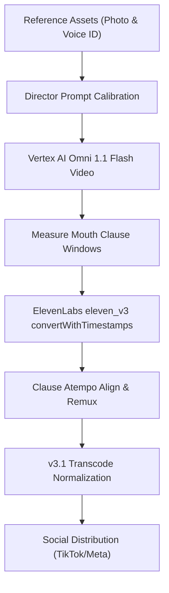
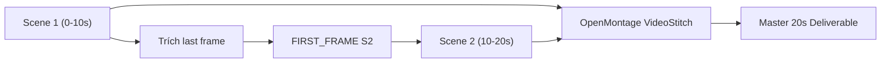

# Avatar-Based UGC Video Synthesis Workflow

| Nguyên lý cốt lõi | Yêu cầu kỹ thuật mô phỏng người thật (Human Mimicry) | Căn cứ kinh nghiệm từ `ugc-video` |
| --- | --- | --- |
| **Chân thực thị giác** | Bắt buộc neo 2 ảnh thực tế: ảnh cận mặt ([`face.jpg`](file:///Users/thevinhnguyen/Documents/computer-science/projects/social-content/projects/ugc-video/assets/images/face.jpg) làm `<IMAGE_REF_0>`) và ảnh trang phục đời thường ([`clothes.jpg`](file:///Users/thevinhnguyen/Documents/computer-science/projects/social-content/projects/ugc-video/assets/images/clothes.jpg) làm `<IMAGE_REF_1>`). | Tránh lỗi người mẫu studio vô hồn; giữ nhận diện thương hiệu nhất quán qua các tập phim. |
| **Dáng vẻ & Tương tác vật lý** | Góc máy nhìn nghiêng 35° từ trên xuống (high-angle POV), rung lắc tự nhiên của máy quay cầm tay; nhân vật đứng thao tác thực tế với máy móc và sản phẩm. | Khắc phục hoàn toàn lỗi vlog tĩnh đối diện (talking head 0 độ) thiếu độ tin cậy của xưởng. |
| **Khử sạch Watermark** | **Tuyệt đối cấm từ khóa tên mạng xã hội (TikTok, Instagram, YouTube)** trong visual prompt. Mô hình video liên kết từ khóa với watermark trong tập dữ liệu huấn luyện và sẽ sinh ảo giác logo góc video (ví dụ `@documentars`). | Bắt buộc thêm chỉ thị phủ định: *"Pristine clean video, absolutely no watermarks, no logos, no text overlays, no usernames"*. |
| **Âm thanh & Khẩu hình** | Dùng ElevenLabs `eleven_v3` (`vi: true`) `convertWithTimestamps` với Voice ID `FXJGVNPXC71BGT9PjlMX` (`vi-northern`), sau đó căn chỉnh từng vế câu (`atempo`) khớp chính xác cửa sổ mở miệng của video. Không dùng `eleven_multilingual_sts_v2` (`vi: false`) vì bị biến âm tiếng Việt và nhiễm phương ngữ ngẫu nhiên của guide audio. | Giữ chuẩn 100% âm sắc miền Bắc của `FXJGVNPXC71BGT9PjlMX` xuyên suốt nhiều cảnh (`Delta F0_mean = 0.2 Hz`) mà không bị đứt từ cuối cảnh. |
| **Quy chuẩn mã hóa social** | Bắt buộc chuẩn hóa VUI tag BT.709, AAC stereo 44.1kHz, chu kỳ GOP 2.0s (`-g 48`), và đặt `moov` atom ở đầu container MP4. | Ngăn chặn triệt để lỗi pixel vỡ hồng/tím trên Instagram/Facebook |

| Trụ cột | Yếu tố đầu vào | Chỉ thị kỹ thuật chi tiết | Kết quả đạt được |
| --- | --- | --- | --- |
| **1. Diện mạo & Trang phục (Image)** | • `face.jpg` (cận cảnh khuôn mặt nét, ánh sáng tự nhiên) • `clothes.jpg` (trang phục lao động/ở nhà thường ngày) | Truyền 2 ảnh qua API: `<IMAGE_REF_0>` neo cấu trúc khuôn mặt, ánh mắt, nụ cười; `<IMAGE_REF_1>` neo kiểu áo, chất vải, họa tiết thêu. | Nhân vật nhất quán 100% diện mạo và phong cách ăn mặc qua các phiên bản video. |
| **2. Dáng đứng & Góc máy (Pose & Camera)** | • Bàn thao tác xưởng (`workbench`) • Đạo cụ thật (phôi giấy, bao bì, máy xén) | Prompt: Góc máy 35° POV nhìn xuống bàn, chuyển động camera thở nhẹ bám theo tay thợ; chia 3 nhịp: mở hộp (0-3s), vuốt nếp giấy (3-7s), nhìn camera chào (7-10s). | Bỏ qua cảm giác diễn viên nhân tạo; tạo phong thái người thợ thành thạo công việc. |
| **3. Giọng nói & Khẩu hình (Voice & Lip-Sync)** | • ElevenLabs Voice ID `FXJGVNPXC71BGT9PjlMX` (*Vietnamese Actual Women Voice*, `vi-northern`) • Khung thời gian khẩu hình từ video Omni Flash | Gọi `textToSpeech.convertWithTimestamps("FXJGVNPXC71BGT9PjlMX", { modelId: "eleven_v3" })` sinh 1 file gốc duy nhất kèm mốc ký tự; dùng `atempo` khớp từng mệnh đề vào cửa sổ khẩu hình của video. | Khớp khẩu hình từng mệnh đề với đúng 100% giọng mẫu `FXJGVNPXC71BGT9PjlMX`, không bị lai giọng vùng miền. |

| Giai đoạn | Mục tiêu | Lệnh thực thi & Công cụ | Sản phẩm đầu ra (Artifacts) |
| --- | --- | --- | --- |
| **1. Thu thập dữ liệu gốc** | Chuẩn bị ảnh diện mạo, trang phục và xác thực ElevenLabs Voice ID | `yt-dlp` tải benchmark; trích xuất `face.jpg`, `clothes.jpg`, cấu hình Voice ID `FXJGVNPXC71BGT9PjlMX` trên ElevenLabs. | Thư mục `assets/images/` và Voice ID `FXJGVNPXC71BGT9PjlMX`. |
| **2. Soạn Director Prompt** | Xây dựng prompt có cấu trúc theo 5 khối thẻ quy chuẩn (đã khử tên platform) | Soạn kịch bản theo nhịp 0-3s (Hook), 3-7s (Trình diễn), 7-10s (CTA) lồng lời thoại tiếng Việt chuẩn; cấm chữ "TikTok". | Đoạn prompt có cấu trúc `[CAMERA]`, `[ENVIRONMENT]`, `[SUBJECT]`, `[ACTION]`, `[AUDIO]`. |
| **3. Sinh video Vertex AI** | Sinh video dọc 9:16 bằng Gemini Omni Flash | Chạy client `google.genai` gọi model `gemini-omni-flash-preview` với 2 ảnh neo b64 và cờ `store=True`. | File video thô `renders/version_raw.mp4` (720×1280 @ 24fps). |
| **4. Đo cửa sổ khẩu hình** | Xác định mốc thời gian bắt đầu/kết thúc từng câu thoại trên video | Dùng `silencedetect` hoặc kiểm tra biên độ âm thanh dẫn từ `renders/version_raw.mp4` để lấy mốc từng mệnh đề. | Danh sách khung thời gian thoại `[start_s, end_s]` cho từng câu. |
| **5. Sinh giọng chuẩn `eleven_v3`** | Tạo giọng đọc tiếng Việt chuẩn của `FXJGVNPXC71BGT9PjlMX` kèm timestamp | Gọi `client.textToSpeech.convertWithTimestamps("FXJGVNPXC71BGT9PjlMX", { modelId: "eleven_v3" })` và căn chỉnh từng mệnh đề vào cửa sổ khẩu hình bằng `atempo` + `loudnorm=-16 LUFS`. | File âm thanh đồng bộ `renders/omni-1.1-flash/tts_v3_20s_aligned.wav`. |
| **6. Ghép muxing video** | Kết hợp hình ảnh Omni Flash với âm thanh `eleven_v3` đã căn chỉnh | `ffmpeg -y -i renders/version_raw.mp4 -i renders/omni-1.1-flash/tts_v3_20s_aligned.wav -c:v copy -c:a aac -map 0:v:0 -map 1:a:0 renders/voice_synced.mp4` | Video đồng bộ khẩu hình `renders/voice_synced.mp4`. |
| **7. Chuẩn hóa v3.1** | Re-encode chống lỗi hiển thị trên nền tảng mạng xã hội | `./scripts/normalize_video.sh renders/voice_synced.mp4` áp dụng ma trận màu BT.709, GOP 2s, FastStart. | File bàn giao chuẩn mạng xã hội `renders/web_optimized.mp4`. |
| **8. Preflight & Đăng tải** | Kiểm tra thông số stream, sạch watermark và đẩy lên kênh | Dùng `ffprobe` xác minh tag BT.709, xem preview 4 góc; dùng `taktik-bot` hoặc `facebook_agent` đăng tải. | Báo cáo kiểm định preflight và link bài đăng chính thức. |

| Thẻ chỉ thị | Quy chuẩn nội dung prompt | Mục đích điều hướng mô hình |
| --- | --- | --- |
| **`[CAMERA & COMPOSITION]`** | `Vertical 9:16 mobile POV. High-angle perspective (35-degree downward tilt) filmed beside workshop workbench, looking down across the table. Natural handheld camera breathing and motion tracking presenter's hands, raw BTS workshop documentary style. Pristine clean video, absolutely no watermarks, no logos, no text overlays, no usernames.` | Ngăn AI mặc định sinh góc chụp thẳng đứng trung tâm kiểu studio; cấm từ "TikTok" để triệt tiêu ảo giác logo `@documentars`. |
| **`[ENVIRONMENT & ATMOSPHERE]`** | `Active industrial paper workshop (xưởng in). Background: commercial guillotine cutter, stacked paper reams on pallets under overhead fluorescent lighting. On workbench: sample paper sheets and carton boxes.` | Loại bỏ phông nền phòng ngủ, phòng khách hoặc bàn văn phòng giả tạo; gán bối cảnh xưởng sản xuất thật. |
| **`[SUBJECT & APPEARANCE]`** | `Young East Asian female artisan matching <IMAGE_REF_0> wearing the casual outfit in <IMAGE_REF_1>. Standing beside workbench, leaning forward naturally, engaging warmly with camera.` | Neo chặt chẽ tỷ lệ gương mặt và phục trang theo ảnh thực tế; nhân vật có tư thế hơi cúi vào bàn làm việc. |
| **`[ACTION & TIMECODE]`** | • `00:00 - 00:03`: Thao tác mở gói/kiện hàng hoặc nhấc sản phẩm khoe trước ống kính. • `00:03 - 00:07`: Cận cảnh tay vuốt chất liệu, gập nếp, thử độ dai, nói chuyện say sưa. • `00:07 - 00:10`: Đặt sản phẩm ngay ngắn, nhìn thẳng camera cười tươi mời gọi liên hệ. | Phân chia tiến trình thời gian rõ ràng, đảm bảo hành động ăn khớp nhịp tâm lý người xem video ngắn. |
| **`[AUDIO & DIALOGUE]`** | Quoted verbatim Vietnamese sentence: `"..."` kèm ghi chú: `Lively spoken Vietnamese dialogue with artisan cadence matching recorded voice. Ambient print shop background sound.` | Ép mô hình sinh khẩu hình miệng phát âm tiếng Việt chuẩn xác thay vì khẩu hình tiếng Anh. |

| Vấn đề âm thanh | Nguyên nhân gốc rễ | Giải pháp chuẩn hóa bắt buộc |
| --- | --- | --- |
| **Giọng robot, ngữ điệu khô cứng** | Gemini Omni Flash chỉ tạo giọng đọc tổng hợp ngẫu nhiên theo prompt văn bản; không thể tự nhân bản giọng người thật. | Sử dụng trực tiếp Voice ID `FXJGVNPXC71BGT9PjlMX` (*Vietnamese Actual Women Voice*, `vi-northern`) trên ElevenLabs. |
| **Hai cảnh bị lệch giọng Bắc/Nam khi dùng STS** | Gemini Omni không có voice seed nên Scene 1 sinh giọng miền Nam (`vi-southern`) còn Scene 2 sinh giọng miền Bắc (`vi-northern`); đồng thời `eleven_multilingual_sts_v2` có `vi: false` (không hỗ trợ tiếng Việt) nên sao chép nguyên xi phương ngữ của audio dẫn và nói ngọng dấu thanh. | **Chuyển sang `eleven_v3` (`vi: true`) `convertWithTimestamps("FXJGVNPXC71BGT9PjlMX", ...)`**: Sinh 1 file TTS nguyên khối kèm mốc thời gian ký tự, sau đó dùng `atempo` ánh xạ từng mệnh đề khớp vào đúng cửa sổ khẩu hình của từng cảnh. |
| **Câu nói bị cắt cụt ở cuối cảnh 1 (`9.7s`)** | Trong `scene1_raw.mp4`, AI tự bắt đầu đọc sớm câu của Scene 2 (`"Khổ ti-"`) ở giây `9.7s` rồi bị cắt ngang tại `10.0s`, gây lặp từ `"Khổ ti- / Khổ tiêu chuẩn"` khi ghép. | Ngắt sạch âm thanh từ `9.35s–10.00s` (lúc nhân vật ngậm miệng chuẩn bị chuyển nhịp) và đặt câu `"Khổ tiêu chuẩn 79x109..."` bắt đầu đúng tại `10.10s`. |
| **Lỗi API 400 khi truyền audio vào Omni** | Model `gemini-omni-flash-preview` chỉ chấp nhận đầu vào multimodal là Văn bản và Hình ảnh; từ chối luồng âm thanh đầu vào. | Tách quy trình thành 2 bước độc lập: Gemini tạo hình ảnh + khung thời gian khẩu hình -> ElevenLabs `eleven_v3` `convertWithTimestamps` khớp thoại sau khi video hoàn thành. |
| **Mất đồng bộ do tần số mẫu** | Audio xuất ra có sample rate không đồng nhất với luồng AAC của mạng xã hội. | Ép tần số mẫu về chuẩn 44.1 kHz stereo AAC (`-ar 44100 -ac 2 -b:a 192k`) trong bước remux và transcode. |

| Lỗi thực tế gặp phải | Nguyên nhân mã hóa (Root Cause) | Cờ xử lý trong `normalize_video.sh` / Pipeline |
| --- | --- | --- |
| **Ảo giác logo TikTok (@documentars)** | Prompt chứa từ khóa mạng xã hội (`"authentic TikTok..."`), mô hình khuếch tán gán trọng số watermark từ dữ liệu crawl vào video. | **Phòng ngừa:** Cấm từ "TikTok" trong prompt, thêm cấm logo. **Khắc phục nguội:** `ffmpeg -vf "delogo=x=545:y=960:w=170:h=125,delogo=x=20:y=50:w=170:h=125"`. |
| **Vỡ mảng màu hồng/tím trên di động** | Xung đột VUI tag giữa không gian màu Rec.601 (`smpte170m`) và ma trận Rec.709 (`bt709`), khiến bộ giải mã phần cứng Meta tính sai ma trận màu. | `-vf "colorspace=all=bt709:trc=bt709:primaries=bt709"` |
| **Video tải chậm, không phát tức thì** | Header atom `moov` nằm ở cuối file (EOF), trình duyệt phải tải hết 100% dung lượng mới bắt đầu giải mã khung hình đầu tiên. | `-movflags +faststart` |
| **Giật lag khi người dùng tua video** | Khoảng cách khung khóa (GOP) của video AI quá lớn (166 frames ~ 7 giây mới có 1 I-frame), gây lỗi block artifact khi tua. | `-g 48 -keyint_min 48 -sc_threshold 0` (cố định 2.0s closed GOP tại 24 fps) |

| Bước kiểm tra | Lệnh xác minh | Tiêu chuẩn ĐẠT (Pass Criteria) |
| --- | --- | --- |
| **1. Kiểm tra không gian màu** | `ffprobe -v error -show_entries stream=color_space,color_primaries,color_transfer -of default=noprint_wrappers=1 <FILE>` | Cả 3 trường đều báo: `bt709`. Tuyệt đối không còn `smpte170m`. |
| **2. Kiểm tra luồng âm thanh** | `ffprobe -v error -select_streams a:0 -show_entries stream=sample_rate,channels,codec_name -of default=noprint_wrappers=1 <FILE>` | Báo: `codec_name=aac`, `sample_rate=44100`, `channels=2`. |
| **3. Kiểm tra vị trí header** | `ffprobe -v trace <FILE> 2>&1 \| grep -E "type:'moov'\|type:'mdat'"` | Atom `moov` phải xuất hiện trước atom `mdat` (FastStart active). |
| **4. Kiểm tra sạch Watermark** | Trích xuất khung hình tại giây 2, 5, 8; kiểm tra góc dưới-phải và trên-trái | Không có logo nốt nhạc TikTok, không có chữ `@documentars` hoặc bất kỳ watermark nào. |
| **5. Kiểm tra khẩu hình trực quan** | Xem video phát lại tại tốc độ 1.0x và 0.5x | Khẩu hình khớp từng âm tiết tiếng Việt; không méo răng, không biến dạng ngón tay. |

## Quy Trình Sản Xuất Video Dài (>10s) Với Kiến Trúc OpenMontage

| Bước ghép nối | Cơ chế kỹ thuật OpenMontage | Hướng dẫn thực thi |
|---|---|---|
| **1. Phân rã kịch bản** | Gemini Omni Flash bị giới hạn cứng 10s. Chia kịch bản dài thành các Scene <=10s: Scene 1 (Hook + Trình diễn cốt lõi), Scene 2 (Ứng dụng thực tế + CTA chốt đơn). | Tham chiếu mẫu cấu trúc tại `projects/OpenMontage/skills/creative/long-form.md`. |
| **2. Khóa mốc nối tiếp `<FIRST_FRAME>`** | Lấy frame cuối của Scene N: `ffmpeg -y -sseof -0.1 -i scene_N.mp4 -update 1 -q:v 2 scene_N_end.jpg`. Gọi `gemini-omni-1.1-flash-preview` với `video_config={"task": "image_to_video"}` và chỉ truyền **duy nhất 1 ảnh** `scene_N_end.jpg`. | Đảm bảo góc máy 35°, vị trí bàn làm việc, thế đứng thợ và ánh sáng giữ nguyên 100% (`MAE < 4.0`). |
| **3. Khóa giọng chuẩn `eleven_v3` nguyên khối (Timestamp-Aligned Single-Pass TTS)** | **Tuyệt đối không dùng `eleven_multilingual_sts_v2`** (do `vi: false` và bị nhiễm giọng miền Nam/Bắc khác nhau giữa 2 video gốc). Gọi `textToSpeech.convertWithTimestamps("FXJGVNPXC71BGT9PjlMX", { modelId: "eleven_v3" })` **1 lần duy nhất** cho toàn bộ kịch bản 20s, tách mốc thời gian từng mệnh đề từ `alignment` và dùng `atempo` khớp vào cửa sổ khẩu hình của từng cảnh + `loudnorm=-16 LUFS`. | Giữ nguyên 100% giọng mẫu miền Bắc `FXJGVNPXC71BGT9PjlMX` ($\Delta F_{0\text{ mean}} = 0.2\text{ Hz}$), phát âm tiếng Việt chuẩn xác và triệt tiêu hoàn toàn tiếng nói dở cuối Scene 1 (`9.35s–10.00s`). |
| **4. Lắp ráp bằng `VideoStitch`** | Dùng OpenMontage `VideoStitch` (`tools/video/video_stitch.py`) với `operation: "stitch"`, `transition: "cut"`, `auto_normalize: True`. | Tự động đồng bộ timebase, 24fps, chuẩn hóa âm thanh và ghép video không sinh vỡ khung hình tại điểm cắt. |
| **5. Chuẩn hóa mạng xã hội** | Chạy `./scripts/normalize_video.sh` trên video ghép để xuất bản phẩm cuối cùng. | Đạt chuẩn BT.709, FastStart và GOP cố định 2.0s trên toàn bộ thời lượng 20s. |
