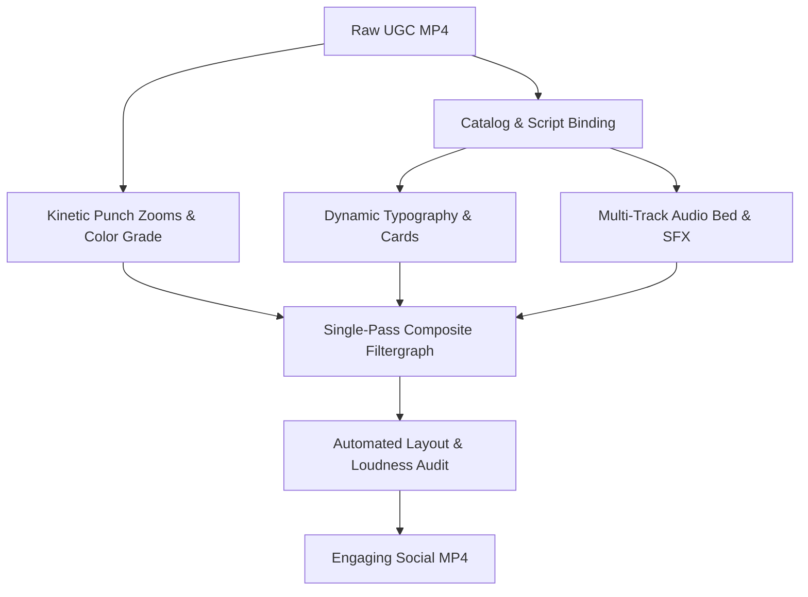

# Short-Form Video Effect Editing Workflow

## Pipeline Overview

| Stage | Command / Invocation Pattern | Primary Input | Produced Artifact | Verification Standard |
|---|---|---|---|---|
| **1. Grounding** | Inspect `product-marketing.json` & `<slug>.json` | Source catalog & TTS script | Factual parameters | Zero foreign jargon; exact catalog model names & selling units. |
| **2. Self-Check** | `python3 projects/ugc-video/scripts/new_system/effect_editor.py --check` | Subtitle & chunking logic | Terminal check pass | Timecode math, word grouping, and multiline formatting verified. |
| **3. Config Authoring** | Author `projects/ugc-video/scripts/new_system/configs/<slug>_effects.json` | Clause timing & SFX cues | Effects specification | Zoom coordinates, audio timing, card texts, and visual cues. |
| **4. Rendering** | `python3 projects/ugc-video/scripts/new_system/effect_editor.py <config>` | Video + BGM + SFX + ASS | Composite MP4 | Single-pass FFmpeg; BT.709 tags; AAC stereo 44.1kHz. |
| **5. Layout Audit** | Run verification checks on rendered frames | Extracted keyframe JPGs | Bounding metrics | Elements stay within portrait safe margins; high text contrast. |

## Core Effect Pillars

| Pillar | Engineering Filter Implementation | Default Profile | Viewer Retention Purpose |
|---|---|---|---|
| **1. Kinetic Punch Zooms** | Segmented `scale` + `crop` dynamically shifted per phrase | `zoom: 1.00x` to `1.12x`, phrase-synchronized | Eliminates camera monotony; resets visual attention every 3–4 seconds. |
| **2. Audio Layering** | `loudnorm=I=-16:TP=-1.5:LRA=11` on amix composite | Ducked BGM bed (-21dB) + timed punch SFX cues | Provides sensory feedback; maintains brisk video momentum. |
| **3. Kinetic Subtitles** | ASS word-level karaoke with micro-bounce scaling | Active word highlight with distinct secondary color | Maximizes silent feed comprehension; focuses viewer gaze. |
| **4. Context Badges** | Styled ASS dialog cards pinned to top and bottom bounds | Top card (`MarginV=150`); CTA card (`MarginV=320`) | Delivers hook in opening seconds; highlights core specifications. |
| **5. Visual Polish** | Isolated segment white flash + contrast/saturation grade | Seam flash (`0.12s`) + 6px dynamic progress bar | Smooths AI scene transitions; gamifies video completion rate. |

## Safe Zones & Visual Layout Contract

| Element | ASS Style Role | Canvas Positioning | Visual Hierarchy | Layout & Containment Contract |
|---|---|---|---|---|
| **Hook Banner** | `HookBanner` | Top Center, below mobile status bar | High-contrast pill card | Script auto-balances multi-line text to preserve lateral safe margins. |
| **Feature Badges** | `BadgeCard` | Top Center, product presentation zone | Translucent card with accent subtext | Script formats spec highlights cleanly above presentation workspace. |
| **Bottom CTA Card** | `BadgeBottom` | Bottom Center, above interface bar | Vibrant callout card | Placed above platform comments, audio tags, and action buttons. |
| **Kinetic Captions** | `CaptionBase` | Lower Third Center | High-legibility stroked typography | Word-by-word active tracking centered below presenter eyeline. |

## Failure Modes & Architectural Defenses

| Failure Mode | Root Vulnerability | Architectural Defense in Script | Verification Gate |
|---|---|---|---|
| **Overflowing Text** | Disabling text wrap without automatic line splitting. | Script automatically wraps and breaks multi-clause phrases into balanced lines. | Rendered text bounding box remains well within video frame width. |
| **Low Contrast / Empty Box** | Matching foreground text and box outline colors in ASS box mode. | Script enforces contrasting foreground and background color definitions. | Non-background text pixels are detected inside card bounding areas. |
| **Solid White Video Start** | Global fade filters holding start color across preceding frames. | Scene transition filters are strictly scoped within individual segment sub-chains. | Opening frames render natural footage immediately without color freeze. |
| **Catalog Spec Drift** | Authoring unverified industry jargon instead of catalog facts. | Configs strictly bind to `product-marketing.json` catalog definitions. | Script terms match catalog names, units, and minimum order values. |

## Automated Verification Protocol

| Verification Step | Command / Tool | Success Standard | Failure Remedy |
|---|---|---|---|
| **1. Script Unit Logic** | `python3 projects/ugc-video/scripts/new_system/effect_editor.py --check` | `self_test passed.` | Fix string formatting, line break logic, or timecode conversion. |
| **2. Video Container** | `ffprobe -v quiet -show_streams -of json <output.mp4>` | 720×1280, 24fps, BT.709, AAC stereo | Verify transcode arguments and aspect ratio scale filters. |
| **3. Audio Loudness** | `ffmpeg -i <output.mp4> -filter:a ebur128 -f null -` | Integrated loudness between -16 and -14 LUFS | Adjust composite audio normalization target or BGM ducking volume. |
| **4. Visual Layout** | Frame extraction at key moments (`ffmpeg -ss ... -vframes 1`) | All cards and captions centered within margins | Adjust script typography scaling or explicit line break tokens. |
| **5. Card Contrast** | Keyframe card crop inspection | Clear text distinction on card background | Verify ASS `OutlineColour` (card fill) vs `PrimaryColour` (text). |
