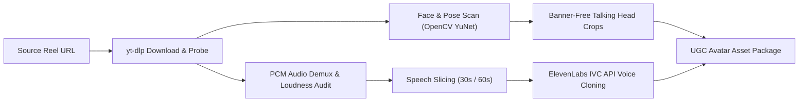

# Reel Talking Head & Voice Cloning Workflow

## Pipeline flow



## Execution stages

| Stage | Goal | Command or Implementation | Artifacts |
|---|---|---|---|
| **1. Download** | Fetch highest-resolution raw vertical video | `uv run yt-dlp -o "projects/ugc-video/local/reel_%(id)s.%(ext)s" --merge-output-format mp4 "<REEL_URL>"` | `reel_<id>.mp4` |
| **2. Probe Metadata** | Inspect container, codec, frame rate, and audio stream | `ffprobe -v error -show_format -show_streams -of json projects/ugc-video/local/reel_<id>.mp4` | Format JSON |
| **3. Face & Pose Scan** | Detect sharpest frontal and turned frames, auditing eye symmetry and yaw | Run YuNet detector with score threshold $\ge 0.75$, computing Laplacian variance and eye-to-nose symmetry | Scored frame candidates |
| **4. Extract Talking Head Crops** | Produce 4 standardized avatar references matching `diep/` convention | Crop `face.jpg` (close-up), `front.jpg` (bust), `clothes.jpg` (outfit), `side.jpg` (3/4 profile) | 4 JPEGs in `assets/images/<slug>/` |
| **5. Extract Voice Audio** | Demux uncompressed master audio and measure LUFS loudness | `ffmpeg -y -i <INPUT>.mp4 -vn -acodec pcm_s16le -ar 44100 -ac 2 <OUTPUT>/voice_full.wav` | `voice_full.wav` & `.mp3` |
| **6. Slice Speech Samples** | Isolate continuous speech window without intro/outro music | `ffmpeg -y -ss <START> -t 30 -i voice_full.wav -c:a copy voice_sample_30s.wav` | `voice_sample_30s.wav` |
| **7. Clone Voice via IVC** | Register instant voice clone via ElevenLabs REST API | `POST https://api.elevenlabs.io/v1/voices/add` with `voice_sample_30s.wav` and `xi-api-key` | Registered Voice ID |
| **8. Preflight & Verify** | Validate zero banner burn-in, acoustic consistency, and metadata | YuNet detection pass on all 4 crops; `loudnorm` audit; `voice_meta.json` generated | Verified asset package |

## Standard asset package structure

All extracted assets must adhere to the project package convention under `projects/ugc-video/`:

```text
projects/ugc-video/
├── assets/
│   ├── images/<creator_slug>/
│   │   ├── face.jpg          # 1354x1804: Centered close-up face crop (<IMAGE_REF_0>)
│   │   ├── front.jpg         # 1354x1804: Frontal talking-head bust (head + shoulders + posture)
│   │   ├── clothes.jpg       # 2406x1804: Detailed crop of outfit fabric, collar, and lapels (<IMAGE_REF_1>)
│   │   └── side.jpg          # 1354x1804: 3/4 angled profile view for head turns and POV realism
│   └── audio/<creator_slug>/
│       ├── voice_full.wav    # Uncompressed PCM 16-bit 44.1kHz stereo full master speech
│       ├── voice_full.mp3    # 192 kbps MP3 full speech track
│       ├── voice_sample_30s.wav  # Clean 30s speech sample (optimal for ElevenLabs IVC)
│       ├── voice_sample_30s.mp3  # 30s MP3 preview
│       ├── voice_sample_60s.wav  # Extended 60s speech sample for long-context TTS models
│       └── voice_meta.json   # Loudness measurements, channel layout, and Voice ID mapping
```

## Image extraction & spatial crop rules

| Asset | Framing Rule | Crop Dimensions | Selection Criteria |
|---|---|---|---|
| **`face.jpg`** | Centered close-up portrait; face bounding box occupies $40\%\text{--}50\%$ of image height | $1354 \times 1804\text{ px}$ | Yaw ratio $\approx 0.0$, eyes wide open, natural relaxed smile, confidence $> 0.80$ |
| **`front.jpg`** | Upper-body bust framing head, shoulders, and chest posture ($y \approx 120\text{--}1560$) | $1354 \times 1804\text{ px}$ | Natural hand posture, head upright, vertical orientation preserved |
| **`clothes.jpg`** | Macro/tight crop on blazer, blouse, fabric texture, and clothing color ($y \approx 800\text{--}1550$) | $2406 \times 1804\text{ px}$ | High-frequency textile texture, zero face pixels, no hands obscuring pattern |
| **`side.jpg`** | 3/4 turn profile showing cheekbone, jawline, and ear ($|\text{yaw}| \ge 0.20$) | $1354 \times 1804\text{ px}$ | Distinct head angle during active speech, sharp edges without motion blur |

## Voice extraction & acoustic normalization rules

| Parameter | Standard Value | Rationale | Verification Command |
|---|---|---|---|
| **Format & Encoding** | PCM 16-bit Little Endian (`pcm_s16le`), 44.1 kHz, Stereo | Uncompressed fidelity prevents double-compression artifacts during neural voice training | `ffprobe -v error -select_streams a:0 -show_entries stream=codec_name,sample_rate,channels <FILE>` |
| **Target Loudness** | $-14.0\text{ to } -16.0\text{ LUFS}$ | Ideal broadcast speech level matching Meta/TikTok feed playback standards | `ffmpeg -i <FILE> -af "loudnorm=print_format=json" -f null -` |
| **True Peak** | $\le -1.50\text{ dBTP}$ | Headroom prevents inter-sample clipping during codec conversion | Measured in `loudnorm` report (`input_tp`) |
| **Loudness Range (LRA)** | $\le 4.0\text{ LU}$ | High consistency across speech utterances without sudden dynamic jumps | Measured in `loudnorm` report (`input_lra`) |
| **Speech Segment Selection** | $10\text{s}\text{--}40\text{s}$ or continuous speech segment | Avoids opening hook sound effects, intro jingles, or outro call-to-action music | Check with `silencedetect=noise=-30dB:d=0.2` |

## ElevenLabs instant voice cloning setup

| Step | Method | Implementation Details |
|---|---|---|
| **1. Prepare Payload** | Multipart `FormData` | Attach `name`, `description`, and `files` containing `voice_sample_30s.wav` |
| **2. API Endpoint** | `POST https://api.elevenlabs.io/v1/voices/add` | Header `xi-api-key: process.env.ELEVENLABS_API_KEY` |
| **3. Capture Voice ID** | Response JSON | Store `voice_id` (e.g. `a95xm5oG7Gvnxoyv5jeJ`) in `voice_meta.json` |
| **4. Synthesis Tier Safety** | Use `output_format="mp3_44100_128"` in [`synthesize_eleven_v3.py`](file:///Users/thevinhnguyen/Documents/computer-science/projects/social-content/projects/ugc-video/scripts/new_system/synthesize_eleven_v3.py) | Note: `mp3_44100_192` triggers HTTP 403 on Standard/Starter subscriptions |
| **5. Model Configuration** | `eleven_v3` (`vi: true`) via `elevenlabs` Python SDK | `VoiceSettings(stability=0.50, similarity_boost=0.85, style=0.0, use_speaker_boost=True)` |

## Traps, failure modes & mitigations

| Trap / Defect | Root Cause | Prevention & Mitigation |
|---|---|---|
| **Banner & Title Pollution** | Creator burns top/middle banners ("Lớp 1 ngày miễn phí...") into video stream | Inspect multi-second samples; choose reels without burned banners, or shift spatial crop boundary below banner line ($y > 350$) |
| **ElevenLabs 403 Tier Error** | Requesting 192k audio on Starter/Standard tier (`output_format_not_allowed`) | Hardcode `output_format="mp3_44100_128"` in [`synthesize_eleven_v3.py`](file:///Users/thevinhnguyen/Documents/computer-science/projects/social-content/projects/ugc-video/scripts/new_system/synthesize_eleven_v3.py) |
| **Closed-Eye / Blinking Crop** | Naive time-based extraction grabs in-between blink frames | Score frames with YuNet eye openness proxy and symmetry ($|\text{nose}_x - \text{eye\_mid}_x| / \text{eye\_dist} < 0.12$) |
| **Watermark Hallucination** | Including platform names ('TikTok', 'Facebook') in visual prompts | Enforce prompt hygiene: *"Pristine clean video, absolutely no watermarks, no logos, no text overlays, no usernames"* |
| **Mouth-Speech Desynchronization** | Raw TTS audio plays across internal closed-mouth pauses or mismatches `visual_dialogue` visemes | Keep Gemini Omni dialogue identical to `clauses`, detect mouth-open intervals with `detect_scene_speech_windows()`, and align words strictly via `partition_words_to_windows_dp()` in [`engine.py`](file:///Users/thevinhnguyen/Documents/computer-science/projects/social-content/projects/ugc-video/scripts/new_system/engine.py) |
