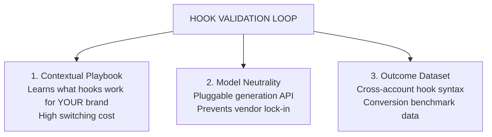

# Full Competitor Research Report: AI Hook & Video Ecosystem

This report documents the findings across the short-form video generation, ad creative, and social distribution landscape to support the positioning of **Hook Validation Loop**.

---

## 1. Master Competitor Matrix (The Loop-Stage Evaluation)

Evaluation stages:
1. **Hook Ideation:** Automated or assisted generation of scroll-stopping angles/scripts.
2. **Video Generation:** Avatar/talking-head rendering or B-roll assembly.
3. **Distribution:** Direct automated publishing (organic or paid) to platforms.
4. **Metrics Ingestion:** Programmatic retrieval of retention, plays, or ROAS data.
5. **AI Diagnosis:** Automated causal diagnosis (*"Why did Hook A win over Hook B?"*).
6. **Closed Loop Regeneration:** Automatically feeding diagnosis data into the next round of generation.

| Platform / Tool | 1. Hook Ideation | 2. Video Gen | 3. Distribution | 4. Metrics Ingestion | 5. AI Diagnosis | 6. Closed Loop (Auto-refeed) | Pricing Tiers | Stated ICP |
| :--- | :---: | :---: | :---: | :---: | :---: | :---: | :--- | :--- |
| **Higgsfield Marketing Studio** | [Yes] Templates & Ref Ads | [Yes] Cinema/UGC Multi-Model | [No] (Manual Export) | [No] | [No] | [No] | $9–$80+/mo (Credits deducted on templates) | Agencies, Visual Marketers, Motion Designers |
| **Creatify.ai (Standard)** | [Yes] URL-to-Script | [Yes] Avatars & B-roll | [No] | [No] | [No] | [No] | $39–$99/mo (Credits scale) | Dropshippers, E-commerce, Performance Marketers |
| **Creatify.ai (AdMax)** | [Yes] URL-to-Script | [Yes] Unlimited Gen | [Partial] Ad Launcher (Paid Ads only) | [Yes] CTR/ROAS (Meta/TikTok Ads) | [Partial] Suggestions / Storyboards | [No] (Human must trigger) | **$299/mo** (Enterprise tier) | Scaled DTC Brands, Performance Agencies |
| **Arcads.ai** | [Partial] Basic Script Prompting | [Yes] Hyper-realistic Avatars | [No] | [No] | [No] | [No] | ~$77–$220+/mo (~$11/video list, gates pricing) | Media Buyers, Direct-Response Marketers |
| **MakeUGC** | [Partial] Batch Hooks | [Yes] UGC Avatars + B-roll | [No] | [No] | [No] | [No] | $49–$119+/mo | E-com Marketers, TikTok Shop Sellers |
| **Syllaby.io** | [Yes] Trend & Viral Outline Engine | [Partial] Faceless & Cloned Avatars | [Yes] Native Social Scheduler | [No] / Minimal | [No] | [No] | $29–$80+/mo | Solo Service Businesses (Real Estate, Lawyers, Doctors) |
| **Motion / Triple Whale / Foreplay** | [Partial] Swipe File / Inspo | [No] | [No] | [Yes] Deep Ad Metrics & Retention | [Partial] Creative Analytics Graphs | [No] (Analytics only) | $99–$500+/mo | Professional Media Buyers |
| **Ayrshare / Buffer / Metricool** | [No] | [No] | [Yes] Multi-network API | [Partial] Standard Engagement Data | [No] | [No] | $18–$150/mo | Social Media Managers |
| **DIY Stack (ChatGPT + CapCut + Sheets)** | [Partial] ChatGPT | [Partial] Manual Editing | [No] Manual Posting | [No] Manual copy-paste | [Partial] Manual ChatGPT analysis | [No] Manual copy-paste | ~$20/mo + 10-15 hrs/wk labour | Bootstrapped Indie Creators |
| **Hook Validation Loop (Target)** | **[Yes] Archetype Generator** | **[Yes] Modular / API-driven** | **[Yes] Auto-Post (Organic & Micro-Ad)** | **[Yes] Ingestion via API Proxies** | **[Yes] Automated Pattern Diagnosis** | **[Yes] Autonomous Round N+1 Regeneration** | **Target: Affordable / Outcome-based** | **Indie Founders, Growth Marketers, Creators** |

---

## 2. Deep-Dive Profiles

### 1. Higgsfield AI (Marketing Studio)
* **What they do well:** High visual fidelity. Integrates cutting-edge video models (Sora, Kling, Veo) and camera controls. Scrapes product pages or mimics reference ad structures well.
* **Where they stop:** They consider their job finished the moment an `.mp4` file is rendered. Zero distribution infrastructure; zero analytics tracking.
* **Credit Model Friction:** Even on paid plans, Marketing Studio draws heavily from credit wallets. Users complain about burning credits on iterations without knowing if the output will perform.
* **Strategic Trajectory:** Higgsfield is chasing cinematic and avatar visual perfection. They are unlikely to build end-to-end social media dispatchers and analytics feedback engines.

### 2. Creatify.ai (The Closest Competitor)
* **What they do well:** URL-to-Video conversion is fast. Automated scriptwriting using direct response frameworks (Hook -> Problem -> Solution).
* **The AdMax Tier ($299/mo):** 
  * Connects to Meta and TikTok ad accounts to track CTR, ROAS, and CPA.
  * Offers an "AI Performance Agent" that highlights winning creatives and suggests storyboard iterations.
* **The Flaws & Whitespace:**
  * **Exclusively focused on Paid Ads:** Cannot run organic testing loops.
  * **Heavy Price Barrier:** At $299/month, it is inaccessible to indie hackers, solo creators, and small brands.
  * **Not a True Loop:** The feedback is passive dashboard reporting; it does not autonomously kick off the next round of generation without human intervention.
  * **Avatar Quality Complaints:** Reddit users frequently note that lower-tier Creatify avatars feel "synthetic" or "cartoonish."

### 3. Arcads.ai
* **What they do well:** Best-in-class talking-head actor realism and natural lip-syncing.
* **Where they stop:** Pure generation engine. Pricing is opaque (hidden behind sign-up), expensive (~$11 per raw video), and credits expire quickly.
* **User Sentiment:** Marketers on Reddit call it an "essential production tool" but express frustration at the cost of testing 5–10 hook variations, as credit costs multiply rapidly.

### 4. Syllaby.io
* **What they do well:** Solves top-of-funnel ideation and video scheduling for non-technical service professionals (real estate, medical, local businesses).
* **Where they stop:** Geared toward faceless videos and calendar posting. Does not possess creative variation testing or performance diagnostic feedback.

---

## 3. Added-Value & Moat Analysis

### A. The Core Added Value: Solving the "Fragmented Tooltax"
Currently, running a systematic hook-testing process requires a user to:
1. Pay **$80–$150/mo** for a generator (Higgsfield, Arcads, or Creatify).
2. Spend **3–5 hours/week** manually scheduling, tagging, and uploading variants.
3. Spend **2–3 hours/week** logging into platform analytics and copying numbers into Google Sheets.
4. Spend **1–2 hours** prompting ChatGPT with the results to draft the next batch.

**Hook Validation Loop collapses this workflow into zero-touch execution:**
* Saves **~8–10 hours per week** of repetitive manual tracking.
* Reduces generation waste by systematically pruning non-performing hook archetypes early.

### B. Defensible Moats

1. **The Brand Playbook (High Switching Cost):** 
   After 10 iterations, the system knows that *Negative/Curiosity hooks* perform 3x better than *Feature/Benefit hooks* for this specific account. If the user leaves for Higgsfield, they reset to zero context.
2. **Model Neutrality:** 
   By not building a custom video generation model from scratch, your product acts as an orchestration and intelligence layer. You can route video generation to whichever engine is cheapest or best (HeyGen, Shotstack, Remotion, Arcads API), insulating your product from generative AI model commoditization.
3. **Outcome-Trained Prompting Engine:** 
   Generators train on aesthetic visual inputs. Your loop collects hard conversion data (retention vs. hook text syntax). Over time, your prompt engine generates statistically superior hook hypotheses.

---

## 4. Strategic Recommendations for Product Roadmapping

1. **Avoid Competing on Video Render Quality:** 
   Do not build avatars or foundational video generation models. Partner with or use rendering APIs (Remotion/Shotstack for dynamic text/motion, HeyGen/Tavus for talking heads).
2. **Offer Hybrid Distribution (Organic + Micro-Ad):** 
   Because organic platform algorithms are noisy on small accounts, allow users to choose:
   * **Mode A (Organic Loop):** Posts to IG Reels / TikTok / YouTube Shorts via scheduling APIs.
   * **Mode B (Micro-Validation Ad Loop):** Uses Meta/TikTok Ads API with a small budget ($3–$5 per variant) to produce statistically significant hook-rate data within 24 hours.
3. **Price Disruption:** 
   Position against Creatify AdMax’s $299/mo enterprise tier by offering an automated testing workflow at **$49–$99/month**.
