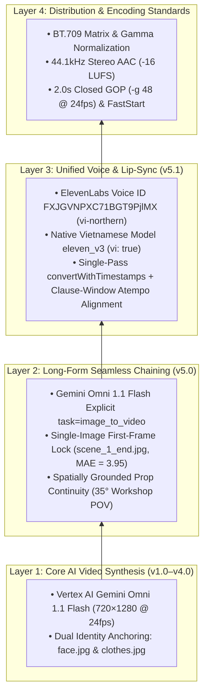

# UGC Video Project: Cumulative Version Stack & Technical Evolution

| Layer / Version | Date | Architectural Milestone | Problem Solved | Retained Deliverable | Reference Document |
| :---: | :---: | :--- | :--- | :--- | :--- |
| **`v1.0–v2.0`** | 2026-10-27 | **Director Prompt Calibration** | Generic studio look & watermark hallucinations | [`renders/post_4.mp4`](file:///Users/thevinhnguyen/Documents/computer-science/projects/social-content/projects/ugc-video/renders/post_4.mp4) | [`prompt-calibration-report.md`](file:///Users/thevinhnguyen/Documents/computer-science/projects/social-content/projects/ugc-video/plans/prompt-calibration-report.md) |
| **`v3.1`** | 2026-10-29 | **Web Transcode & Automation** | Mobile pink macroblock corruption & DOM click timeout | [`scripts/normalize_video.sh`](file:///Users/thevinhnguyen/Documents/computer-science/projects/social-content/projects/ugc-video/scripts/normalize_video.sh) | [`video-encoding-facebook-fix-report.md`](file:///Users/thevinhnguyen/Documents/computer-science/projects/social-content/projects/ugc-video/plans/video-encoding-facebook-fix-report.md) |
| **`v4.0`** | 2026-10-29 | **Post 4: Wedding Card Paper (10s)** | Viral structure alignment (`rec-01` hook) | [`renders/post_4_web_optimized.mp4`](file:///Users/thevinhnguyen/Documents/computer-science/projects/social-content/projects/ugc-video/renders/post_4_web_optimized.mp4) | [`post-4-production-plan.md`](file:///Users/thevinhnguyen/Documents/computer-science/projects/social-content/projects/ugc-video/plans/post-4-production-plan.md) |
| **`v5.0`** | 2026-10-30 | **Long-Form Chaining (`S1` Veo 3.1 vs `S4` Omni 1.1)** | Multi-clip jump-cut (`MAE 40.73` $\rightarrow$ `3.95`) & prop scale drift | [`renders/omni-1.1-flash/scene2_omni11_raw.mp4`](file:///Users/thevinhnguyen/Documents/computer-science/projects/social-content/projects/ugc-video/renders/omni-1.1-flash/scene2_omni11_raw.mp4) | [`long-form-chaining-solutions-review.md`](file:///Users/thevinhnguyen/Documents/computer-science/projects/social-content/projects/ugc-video/plans/long-form-chaining-solutions-review.md) |
| **`v5.1`** | **2026-10-30** | **Unified `eleven_v3` Timestamp-Aligned Voice** | Southern/Northern STS accent split & `9.7s` cut-off stutter | [`renders/omni-1.1-flash/post_4_omni11_20s_web_optimized.mp4`](file:///Users/thevinhnguyen/Documents/computer-science/projects/social-content/projects/ugc-video/renders/omni-1.1-flash/post_4_omni11_20s_web_optimized.mp4) | [`long-form-transition-audio-debug-plan.md`](file:///Users/thevinhnguyen/Documents/computer-science/projects/social-content/projects/ugc-video/plans/long-form-transition-audio-debug-plan.md) |

| Step | Script / Tool | Input | Output | Purpose |
|---|---|---|---|---|
| **1. Scene 1 (0–10s)** | [`local/generate_post_4_video.py`](file:///Users/thevinhnguyen/Documents/computer-science/projects/social-content/projects/ugc-video/local/generate_post_4_video.py) | [`face.jpg`](file:///Users/thevinhnguyen/Documents/computer-science/projects/social-content/projects/ugc-video/assets/images/face.jpg), [`clothes.jpg`](file:///Users/thevinhnguyen/Documents/computer-science/projects/social-content/projects/ugc-video/assets/images/clothes.jpg) | [`renders/omni-1.1-flash/scene1_raw.mp4`](file:///Users/thevinhnguyen/Documents/computer-science/projects/social-content/projects/ugc-video/renders/omni-1.1-flash/scene1_raw.mp4) | Generates 10s Scene 1 and extracts [`scene_1_end.jpg`](file:///Users/thevinhnguyen/Documents/computer-science/projects/social-content/projects/ugc-video/assets/images/scene_1_end.jpg). |
| **2. Scene 2 (10–20s)** | [`local/generate_scene_2_video.py`](file:///Users/thevinhnguyen/Documents/computer-science/projects/social-content/projects/ugc-video/local/generate_scene_2_video.py) | [`scene_1_end.jpg`](file:///Users/thevinhnguyen/Documents/computer-science/projects/social-content/projects/ugc-video/assets/images/scene_1_end.jpg) (`task="image_to_video"`) | [`renders/omni-1.1-flash/scene2_omni11_raw.mp4`](file:///Users/thevinhnguyen/Documents/computer-science/projects/social-content/projects/ugc-video/renders/omni-1.1-flash/scene2_omni11_raw.mp4) | Locks Frame 0 (`MAE = 3.95`) and preserves prop scale on `gemini-omni-1.1-flash-preview`. |
| **3. Unified Voice (`eleven_v3`)** | [`scripts/sync_eleven_v3_voice.js`](file:///Users/thevinhnguyen/Documents/computer-science/projects/social-content/projects/ugc-video/scripts/sync_eleven_v3_voice.js) | Voice ID `FXJGVNPXC71BGT9PjlMX` | [`tts_v3_20s_aligned.wav`](file:///Users/thevinhnguyen/Documents/computer-science/projects/social-content/projects/ugc-video/renders/omni-1.1-flash/tts_v3_20s_aligned.wav) | Synthesizes single-pass `vi-northern` speech and aligns clauses to mouth windows. |
| **4. Seamless 20s Stitch & Normalize** | [`scripts/stitch_20s_video.py`](file:///Users/thevinhnguyen/Documents/computer-science/projects/social-content/projects/ugc-video/scripts/stitch_20s_video.py) + [`scripts/normalize_video.sh`](file:///Users/thevinhnguyen/Documents/computer-science/projects/social-content/projects/ugc-video/scripts/normalize_video.sh) | `scene1_raw.mp4` + `scene2_omni11_raw.mp4` + `tts_v3_raw.mp3` | [`post_4_omni11_20s_web_optimized.mp4`](file:///Users/thevinhnguyen/Documents/computer-science/projects/social-content/projects/ugc-video/renders/omni-1.1-flash/post_4_omni11_20s_web_optimized.mp4) | Aligns 6 clauses to mouth windows, stitches Scene 1 + Scene 2, and normalizes to BT.709, 44.1kHz stereo AAC (`-16 LUFS`), `-g 48`, and `+faststart`. |
