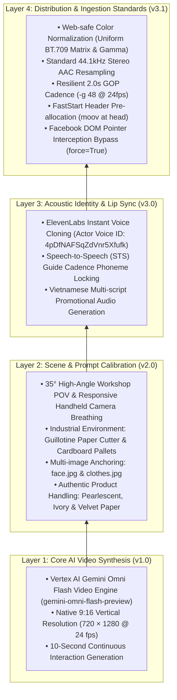

# UGC Video Project: Cumulative Version Stack & Technical Evolution

> **Active Production Stack: `v3.1` (Current Cumulative Build)**  
> Each version represents a permanent capability layer stacked chronologically into the production pipeline. Prior layers are foundational milestones that remain active components of the generation and publishing architecture.

---

## 1. Cumulative Architecture Stack

---

## 2. Chronological Version Ledger

| Layer / Version | Date | Architectural Milestone | Problem Solved | Cumulative Capabilities Added | Retained Milestone Deliverable | Reference Report |
| :---: | :---: | :--- | :--- | :--- | :--- | :--- |
| **`v1.0`** | 2026-10-27 | **Core Engine Feasibility** | Baseline video generation capability | Established Vertex AI Gemini Omni Flash interaction pipeline; proved 9:16 portrait video generation at 24 fps. | `renders/ugc_test_10s.mp4` (v1) | [`prompt-calibration-report.md`](file:///Users/thevinhnguyen/Documents/computer-science/projects/social-content/projects/ugc-video/plans/prompt-calibration-report.md) |
| **`v2.0`** | 2026-10-27 | **Director Prompt Calibration** | Generic studio look & foreign language | Structured director prompt framework (`[CAMERA]`, `[ENVIRONMENT]`, `[SUBJECT]`, `[ACTION]`); established industrial print shop aesthetic, high-angle BTS camera dynamic, and authentic Vietnamese dialogue. | `renders/ugc_test_10s.mp4` (v2) | [`prompt-calibration-report.md`](file:///Users/thevinhnguyen/Documents/computer-science/projects/social-content/projects/ugc-video/plans/prompt-calibration-report.md) |
| **`v3.0`** | 2026-10-28 | **Voice Cloning & Lip-Sync** | Robotic voice & lip-sync desynchronization | Onboarded ElevenLabs IVC (`4pDfNAFSqZdVnr5Xfufk`) from real actor audio; applied Speech-to-Speech (`eleven_multilingual_sts_v2`) to lock actor vocal timbre frame-accurately to video mouth movements. | [`renders/version_3_sts_synced.mp4`](file:///Users/thevinhnguyen/Documents/computer-science/projects/social-content/projects/ugc-video/renders/version_3_sts_synced.mp4) | [`voice-cloning-lipsync-report.md`](file:///Users/thevinhnguyen/Documents/computer-science/projects/social-content/projects/ugc-video/plans/voice-cloning-lipsync-report.md) |
| **`v3.1`** | **2026-10-29** | **Web Transcode & Automation** | Mobile pink macroblock corruption & DOM click timeout | Standardized VUI tags to BT.709, resampled audio to 44.1 kHz stereo AAC, enforced 2.0s GOP (`-g 48`), pre-allocated FastStart header, and patched Facebook agent with `force=True` on wizard steps. | [`renders/version_3_web_optimized.mp4`](file:///Users/thevinhnguyen/Documents/computer-science/projects/social-content/projects/ugc-video/renders/version_3_web_optimized.mp4) | [`video-encoding-facebook-fix-report.md`](file:///Users/thevinhnguyen/Documents/computer-science/projects/social-content/projects/ugc-video/plans/video-encoding-facebook-fix-report.md) |

---

## 3. Integrated Production Pipeline (End-to-End Stack)

Future sessions execute this cumulative stack in order; every layer feeds into the next:

| Step | Layer | Tool / Command | Input Artifact | Output Artifact | Technical Contribution |
|---|---|---|---|---|---|
| **1** | `v1.0 + v2.0` | [`local/generate_version_3_video.py`](file:///Users/thevinhnguyen/Documents/computer-science/projects/social-content/projects/ugc-video/local/generate_version_3_video.py) | [`face.jpg`](file:///Users/thevinhnguyen/Documents/computer-science/projects/social-content/projects/ugc-video/assets/images/face.jpg), [`clothes.jpg`](file:///Users/thevinhnguyen/Documents/computer-science/projects/social-content/projects/ugc-video/assets/images/clothes.jpg) | [`renders/version_3.mp4`](file:///Users/thevinhnguyen/Documents/computer-science/projects/social-content/projects/ugc-video/renders/version_3.mp4) | Synthesizes base video using calibrated director prompt and dual reference image anchors. |
| **2** | `v3.0` | [`scripts/generate_cloned_actor_speeches.js`](file:///Users/thevinhnguyen/Documents/computer-science/projects/social-content/projects/ugc-video/scripts/generate_cloned_actor_speeches.js) | [`actor_voice.wav`](file:///Users/thevinhnguyen/Documents/computer-science/projects/social-content/projects/ugc-video/assets/audio/actor_voice.wav) | [`assets/audio/v3_sts_cloned_voice.mp3`](file:///Users/thevinhnguyen/Documents/computer-science/projects/social-content/projects/ugc-video/assets/audio/v3_sts_cloned_voice.mp3) | Generates cloned actor speech and locks cadence to video phonemes via ElevenLabs STS. |
| **3** | `v3.0` | `ffmpeg -i version_3.mp4 -i audio.mp3 -c:v copy` | `version_3.mp4` + `v3_sts_cloned_voice.mp3` | [`renders/version_3_sts_synced.mp4`](file:///Users/thevinhnguyen/Documents/computer-science/projects/social-content/projects/ugc-video/renders/version_3_sts_synced.mp4) | Remuxes synchronized actor speech track onto the visual master. |
| **4** | `v3.1` | [`scripts/normalize_video.sh`](file:///Users/thevinhnguyen/Documents/computer-science/projects/social-content/projects/ugc-video/scripts/normalize_video.sh) | `version_3_sts_synced.mp4` | [`renders/version_3_web_optimized.mp4`](file:///Users/thevinhnguyen/Documents/computer-science/projects/social-content/projects/ugc-video/renders/version_3_web_optimized.mp4) | Re-encodes to uniform BT.709, 44.1 kHz stereo AAC, 2.0s GOP (`-g 48`), and `+faststart`. |
| **5** | `v3.1` | `tools/facebook_agent post` | `version_3_web_optimized.mp4` + copy | [Live Facebook Post](https://www.facebook.com/61595289277974/posts/122111179869509642) | Publishes directly to Page `61595289277974` with hashtag overlay bypass (`force=True`). |

---

## 4. Retained Asset Map Across All Layers

All generated assets are retained for historical provenance, model comparison, and future re-renders:

| Layer | File Path | Format & Specs | Role in the Project |
|---|---|---|---|
| **v1.0** | [`local/ref_start/`](file:///Users/thevinhnguyen/Documents/computer-science/projects/social-content/projects/ugc-video/local/ref_start/) | 1 fps extracted JPEGs | Visual structural reference extracted from real TikTok benchmark footage. |
| **v2.0** | [`assets/images/`](file:///Users/thevinhnguyen/Documents/computer-science/projects/social-content/projects/ugc-video/assets/images/) | High-res JPEG turnaround anchors | Character face anchor ([`face.jpg`](file:///Users/thevinhnguyen/Documents/computer-science/projects/social-content/projects/ugc-video/assets/images/face.jpg)) and outfit anchor ([`clothes.jpg`](file:///Users/thevinhnguyen/Documents/computer-science/projects/social-content/projects/ugc-video/assets/images/clothes.jpg)). |
| **v2.0** | [`renders/version_3.mp4`](file:///Users/thevinhnguyen/Documents/computer-science/projects/social-content/projects/ugc-video/renders/version_3.mp4) | MP4 720×1280 @ 24fps | Clean, pristine base video render direct from Gemini Omni Flash. |
| **v3.0** | [`assets/audio/actor_voice.wav`](file:///Users/thevinhnguyen/Documents/computer-science/projects/social-content/projects/ugc-video/assets/audio/actor_voice.wav) | 16-bit PCM WAV (29.37s) | Master training audio recorded from mobile phone footage. |
| **v3.0** | [`assets/audio/v3_sts_cloned_voice.mp3`](file:///Users/thevinhnguyen/Documents/computer-science/projects/social-content/projects/ugc-video/assets/audio/v3_sts_cloned_voice.mp3) | MP3 44.1 kHz (10.03s) | Standalone STS audio master matched to video mouth cadence. |
| **v3.0** | [`renders/version_3_sts_synced.mp4`](file:///Users/thevinhnguyen/Documents/computer-science/projects/social-content/projects/ugc-video/renders/version_3_sts_synced.mp4) | MP4 720×1280 @ 24fps | Muxed lip-sync deliverable (base for normalization pass). |
| **v3.1** | [`renders/version_3_web_optimized.mp4`](file:///Users/thevinhnguyen/Documents/computer-science/projects/social-content/projects/ugc-video/renders/version_3_web_optimized.mp4) | MP4 (BT.709, 44.1kHz AAC) | **Current Production Deliverable** for web and mobile social feeds. |
| **v3.1** | [`scripts/normalize_video.sh`](file:///Users/thevinhnguyen/Documents/computer-science/projects/social-content/projects/ugc-video/scripts/normalize_video.sh) | Executable bash utility | Normalizer script encoding social media safety standards into one command. |
