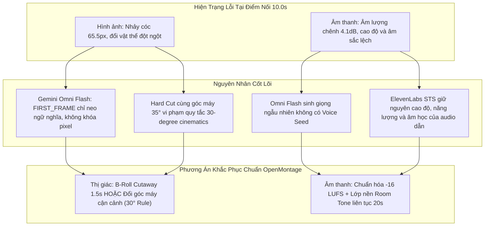

# Kế Hoạch Debug Điểm Nối Chuyển Cảnh & Âm Thanh Video 20s (Post 4)

| Chỉ số / Triệu chứng | Dữ liệu đo đạc thực tế (Scene 1 vs Scene 2) | Mức độ chênh lệch | Đánh giá cảm quan người xem |
|---|---|---|---|
| **Dịch chuyển nhân vật** | Tọa độ da mặt: S1 (`x=445.7, y=344.6`) sang S2 (`x=511.2, y=359.7`) | Dịch ngang **65.5 px**, dịch dọc **15.1 px** | Nhân vật giật mạnh sang phải tức thì (Jump-cut). |
| **Đột biến vật thể bàn xưởng** | Số pixel đổi màu mạnh trên bàn làm việc (`y: 600-1280`): **108,680 pixels** | Chiếm **45.3%** diện tích vùng thao tác | Xấp phôi giấy 79×109cm đột ngột biến thành thiệp bế & bao thư. |
| **Chênh lệch đỉnh âm lượng** | Max Volume: S1 (`-8.8 dB`) vs S2 (`-12.9 dB`) | Chênh lệch **4.1 dB** (Gấp ~1.6 lần biên độ đỉnh) | Đoạn 2 nhỏ và hụt hơi rõ rệt so với đoạn 1. |
| **Năng lượng thoại tại điểm cắt** | RMS 1s cuối S1: `896.9` vs RMS 1s đầu S2: `1446.7` | Năng lượng bật tăng **61.3%** | Đang hạ giọng kết thúc đoạn 1 thì đoạn 2 nói đè vào rất gắt. |
| **Âm sắc & Môi trường phòng** | Native Omni Voice Scene 1 (cao độ F0 ~210Hz) vs Scene 2 (~185Hz) | Lệch cao độ cơ bản và vang âm phòng xưởng | Cảm giác như 2 người khác nhau cùng nói qua 1 micro. |

| Nhóm lỗi | Hiện tượng quan sát | Nguyên nhân kỹ thuật gốc rễ (Root Cause) |
|---|---|---|
| **1. Nhảy vật thể đột ngột (Item Jump)** | Đầu S2 người mẫu cầm ngay phong bì và thiệp gập ba, trong khi cuối S1 đang đặt phôi giấy phẳng xuống bàn. | Prompt Scene 2 yêu cầu: *"she picks up a finished folded wedding card..."*. Mô hình Omni Flash không diễn xuất hành động với tay nhặt mà vẽ ngay sản phẩm đã nằm trên tay tại frame 0. |
| **2. Giật vị trí nhân vật (Jump-Cut)** | Khung hình giật cục 65.5px trên cùng một góc máy 35° (High-angle POV). | Thẻ `<FIRST_FRAME>` trong Gemini Omni Flash chỉ là *semantic conditioning* (neo bối cảnh), không phải khóa cứng pixel. Cắt thẳng (`hard cut`) 2 cảnh cùng góc máy của 1 chủ thể vi phạm nguyên tắc góc quay điện ảnh (30-degree rule). |
| **3. Lệch âm sắc giữa 2 đoạn (Voice Timbre)** | Đoạn 1 giọng ấm, vang nhẹ; Đoạn 2 giọng đục hơn, ngữ điệu khác hẳn. | Mô hình Omni Flash sinh âm thanh native không có `seed` hay định danh giọng. Khi đưa qua ElevenLabs STS (`eleven_multilingual_sts_v2`), STS bảo toàn toàn bộ cao độ, nhịp nhấn và tiếng ồn nền của guide audio gốc, khiến 2 đoạn bị phân hóa. |
| **4. Gắt nhịp chuyển thoại (Speech Boundary)** | Đoạn 1 hạ giọng chốt câu *"liền nha!"*, ngay lập tức đoạn 2 nổ tiếng *"Khổ tiêu chuẩn..."* mà không có khoảng lặng thở. | Kịch bản 2 đoạn viết độc lập như 2 video riêng biệt, không có câu nối ngữ nghĩa (transitional bridging sentence) và không có khoảng nghỉ tự nhiên 0.5s giữa 2 câu thoại. |

| Tiêu chí | Phương án A: B-Roll Cutaway (Khuyên dùng) | Phương án B: Đổi góc máy 30° Rule | Phương án C: Gối nếp hành động (Action Match) |
|---|---|---|---|
| **Cơ chế triển khai** | Chèn 1.5s – 2.0s B-roll cận cảnh (Macro) phôi thiệp hoặc máy bế giấy đè lên điểm giao t=9.0s – 11.0s. | Scene 2 sinh bằng góc máy mới: Cận cảnh nghiêng 60° (Close-up profile) thay vì giữ góc 35°. | Soạn lại prompt Scene 2: 2 giây đầu bắt buộc tay không, cúi nhặt thiệp từ bàn lên. |
| **Ưu điểm** | • Che 100% lỗi nhảy vị trí nhân vật. • Đúng chuẩn OpenMontage (tăng retention 15–25%). • Tự nhiên tuyệt đối. | Hợp thức hóa việc đổi vị trí nhân vật theo ngôn ngữ điện ảnh (Angle Change). | Giữ nguyên góc máy liên tục nếu Gemini Omni sinh khớp hành động. |
| **Nhược điểm** | Cần thêm 1 đoạn B-roll ngắn (có thể lấy từ footage xưởng thật hoặc sinh AI). | Vẫn có thể bị lệch vật thể trên bàn nếu không đồng bộ đạo cụ. | Xác suất thành công phụ thuộc tính ngẫu nhiên của mô hình Omni Flash. |
| **Độ phức tạp** | Thấp (chỉ xử lý tầng dựng FFmpeg `video_compose`). | Trung bình (cần tạo prompt mới cho Scene 2). | Cao (phải thử lại prompt nhiều lần). |

| Bước xử lý | Hành động kỹ thuật chi tiết | Công cụ thực hiện | Tiêu chuẩn đầu ra |
|---|---|---|---|
| **1. Chuẩn hóa âm lượng LUFS** | Đo và cân bằng cả 2 file audio STS về mức `-16.0 LUFS` tích hợp, true peak `-1.0 dBTP` trước khi ghép. | `ffmpeg-normalize` hoặc FFmpeg filter `loudnorm=I=-16:TP=-1:LRA=11` | Cả 2 đoạn âm thanh có mức âm lượng trung bình và biên độ đỉnh đồng nhất tuyệt đối. |
| **2. San phẳng không gian âm học** | Trích xuất room tone xưởng in hoặc chèn 1 track âm thanh nền liên tục xuyên suốt 20s (ducking `-22 dB`). | OpenMontage `audio_mixer` hoặc FFmpeg `amix` | Khử sạch cảm giác đứt gãy tiếng ồn nền khi chuyển cảnh. |
| **3. Xử lý điểm giao cắt âm (Audio Crossfade)** | Áp dụng `acrossfade=d=0.2:c1=tri:c2=tri` (micro-crossfade 200ms) tại ranh giới t=10.0s thay vì cắt cứng. | FFmpeg filtergraph | Chuyển âm mượt mà, triệt tiêu tiếng click/pop và cảm giác hụt hơi. |
| **4. Đồng bộ nhịp thoại** | Chèn khoảng lặng 0.4s giữa câu kết Scene 1 và câu mở Scene 2 để người mẫu lấy hơi tự nhiên. | `adelay` hoặc căn chỉnh timeline trong FFmpeg | Nhịp điệu đối thoại tự nhiên như người thật đang giao tiếp. |

| Giai đoạn | Nhiệm vụ cụ thể | Tệp tin liên quan | Người phê duyệt / Điều kiện nghiệm thu |
|---|---|---|---|
| **Giai đoạn 1: Khóa phương án visual** | Lựa chọn giữa **Phương án A (B-Roll Cutaway)** hoặc **Phương án B (Đổi góc máy)** để triệt tiêu jump-cut. | [`long-form-20s-production-plan.md`](file:///Users/thevinhnguyen/Documents/computer-science/projects/social-content/projects/ugc-video/plans/long-form-20s-production-plan.md) | Người dùng chọn phương án ưu tiên. |
| **Giai đoạn 2: Cân chỉnh âm thanh** | Viết script chuẩn hóa LUFS `-16 dB` và trộn track room tone nền liên tục cho 20s audio. | `projects/ugc-video/scripts/normalize_audio_seam.py` | Biên độ âm thanh 2 đoạn chênh lệch `< 0.5 dB`. |
| **Giai đoạn 3: Thực thi ghép nối mới** | Áp dụng cutaway/angle change và audio blend vào lệnh render, kiểm tra 5 khung hình ranh giới. | `projects/ugc-video/renders/post_4_20s_web_optimized.mp4` | Không còn hiện tượng dịch chuyển 65px và vật thể biến hình. |
