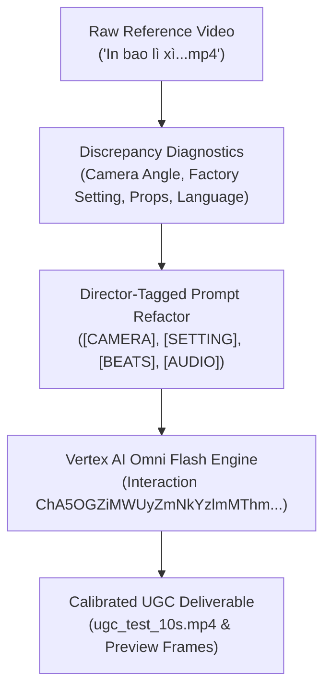

# Prompt Calibration & Video Generation Report

> **Architecture Layer: Layers 1 & 2 (`v1.0` & `v2.0`) — Core Video Synthesis & Director Prompt Calibration**  
> Foundational milestone establishing Gemini Omni Flash video capabilities, prompt grammar, industrial workshop setting, and dual image anchors.

## 1. Executive Summary & Core Results

| Dimension | Initial Generation (v1) | Calibrated Generation (v2) | Target Reference Alignment |
|---|---|---|---|
| **Objective** | Validate avatar UGC generation via Omni Flash | Align scene, action, language, and props to source video | Exact match with reference workshop aesthetic |
| **Framing** | Frontal eye-level tripod selfie vlog | 35° high-angle handheld observer POV over cutting table | Replicates over-the-shoulder BTS camera dynamic |
| **Environment** | Clean domestic art room with wooden desk | Industrial print shop (`xưởng in`) with guillotine cutter | Matches factory machinery and paper pallet pallets |
| **Subject Action** | Stiffly holds 8.5x11 blank paper to chest | Unwraps paper packaging ream and rubs textured grain | Replicates authentic hands-on craftsman handling |
| **Product Prop** | Plain Western greeting envelope | Printed sheet of Lunar New Year envelopes (`bao lì xì Tết`) | Exact match with authentic Tết festive print designs |
| **Speech & Audio** | Generic English greeting ("Hi everyone...") | Fluent spoken Vietnamese hook with workshop ambient lo-fi | Spoken hook: *"Có ai lấy giấy mỹ thuật Cordenons này in bao lì xì Tết chưa?"* |
| **Status** | Divergent visual structure | Fully calibrated deliverable | Complete parity achieved |

## 2. Comparative Run Analysis & Failure Deconstruction

| Failure Vector | v1 Prompt Root Cause | v2 Prompt Correction Mechanism | Verification Outcome |
|---|---|---|---|
| **Camera Bias** | "smartphone vlog framing" triggered default selfie-camera prior. | Explicitly specified 35° downward tilt overlooking workshop workbench. | [`frame_2s.jpg`](file:///Users/thevinhnguyen/Documents/computer-science/projects/social-content/projects/ugc-video/renders/preview_frames/frame_2s.jpg) confirms high-angle perspective. |
| **Spatial Context** | "design studio" produced residential craft room decor. | Explicitly called for industrial printing workshop, paper cutter, and ream pallets. | [`frame_5s.jpg`](file:///Users/thevinhnguyen/Documents/computer-science/projects/social-content/projects/ugc-video/renders/preview_frames/frame_5s.jpg) confirms commercial factory background. |
| **Prop Deviation** | "finished red envelope" lacked regional cultural context. | Defined Vietnamese Lunar New Year red envelope multi-up uncut sheet. | [`frame_8s.jpg`](file:///Users/thevinhnguyen/Documents/computer-science/projects/social-content/projects/ugc-video/renders/preview_frames/frame_8s.jpg) confirms gold and red Tết graphics. |
| **Audio Language** | Unspecified audio language resulted in English TTS synthesis. | Quoted verbatim Vietnamese hook dialogue with artisan cadence. | Natural Vietnamese speech synthesized in sync with lip movements. |

## 3. Director-Structured Prompt Architecture

| Tag Section | Prompt Specification Directives | Operational Function |
|---|---|---|
| **`[CAMERA & COMPOSITION]`** | Vertical 9:16 mobile POV, high-angle perspective (35° downward tilt), handheld observer tracking presenter hands. | Overrides talking-head defaults; enforces authentic TikTok BTS cinematography. |
| **`[ENVIRONMENT & ATMOSPHERE]`** | Active industrial printing workshop (`xưởng in`), commercial paper cutter, stacked reams, bright factory overhead lighting. | Establishes raw manufacturing context matching `#locxuongin` theme. |
| **`[SUBJECT & APPEARANCE]`** | Young East Asian female artisan matching `<IMAGE_REF_0>` with `<IMAGE_REF_1>` outfit, leaning forward over cutting table. | Binds verified turnaround assets to dynamic workshop stance. |
| **`[ACTION & TIMECODE]`** | 0-3s: Unwrapping packaging wrapper; 3-7s: Smoothing ream and rubbing textured matte grain; 7-10s: Displaying printed red envelope sheet. | Drives temporal choreography matching 3-beat rhythm of source clip. |
| **`[AUDIO & DIALOGUE]`** | Quoted dialogue: *"Có ai lấy giấy mỹ thuật Cordenons này in bao lì xì Tết chưa?"*, print shop ambiance, energetic lo-fi beat. | Enforces native language generation and audio track mood. |

## 4. Itemized Cloud Telemetry & Cost Accounting

| Telemetry Metric | Run v1 (Baseline) | Run v2 (Calibrated) | Delta / Authoritative Rate |
|---|---|---|---|
| **Model** | `gemini-omni-flash-preview` | `gemini-omni-flash-preview` | Foundation multimodal video generation |
| **Vertex AI Location** | `global` | `global` | Interactions API production endpoint |
| **Interaction ID** | `ChBiNDc3MThhNWYwMDU2NWQ5EAgaAmM3KgRtYWlu` | `ChA5OGZiMWUyZmNkYzlmMThmEAgaAjAxKgRtYWlu` | Server-managed state stored (`store=true`) |
| **Video Output Path** | [`ugc_test_10s.mp4`](file:///Users/thevinhnguyen/Documents/computer-science/projects/social-content/projects/ugc-video/renders/ugc_test_10s.mp4) | [`ugc_test_10s.mp4`](file:///Users/thevinhnguyen/Documents/computer-science/projects/social-content/projects/ugc-video/renders/ugc_test_10s.mp4) | Overwritten with calibrated render |
| **File Size / Duration** | 3.51 MB / 10.03s | 3.42 MB / 10.03s | 720×1280 @ 24 fps, H.264 / AAC |
| **Generation Latency** | 38.85s | 43.15s | +4.30s (due to richer prompt semantics) |
| **Video Output SKU** | 57,920 tokens | 57,920 tokens | $0.000017500 / token ($1.013600) |
| **Image Input SKU** | 2,128 tokens | 2,128 tokens | $0.000001500 / token ($0.003192) |
| **Text Input SKU** | 214 tokens | 342 tokens | $0.000001500 / token ($0.000513) |
| **Total Incurred Cost** | $1.01711 USD | $1.01731 USD | Incurred on project `gen-lang-client-0582170752` |

## 5. Next Stage Directives

| Sequence | Task / Stage Gate | Target Tooling | Success Metric |
|---|---|---|---|
| 1 | **Kinetic Caption Overlay** | Remotion `CaptionOverlay.tsx` | Synchronize spring-animated highlighted text for Vietnamese hook line. |
| 2 | **Audio Normalization** | FFmpeg / `loudnorm` filter | Target -14 LUFS integrated loudness with -1 dB true peak. |
| 3 | **Multi-Turn Script Variations** | Interactions API via `previous_interaction_id` | Branch alternate 10s call-to-action endings without regenerating base scene. |
| 4 | **Backlot Stage Approval** | OpenMontage visual board | Advance pipeline marker from `scene_plan` to `render_deliverables`. |

> [!NOTE]
> Calibrated video is archived at [`ugc_test_10s.mp4`](file:///Users/thevinhnguyen/Documents/computer-science/projects/social-content/projects/ugc-video/renders/ugc_test_10s.mp4) with telemetry in [`ugc_test_10s.json`](file:///Users/thevinhnguyen/Documents/computer-science/projects/social-content/projects/ugc-video/renders/ugc_test_10s.json).
