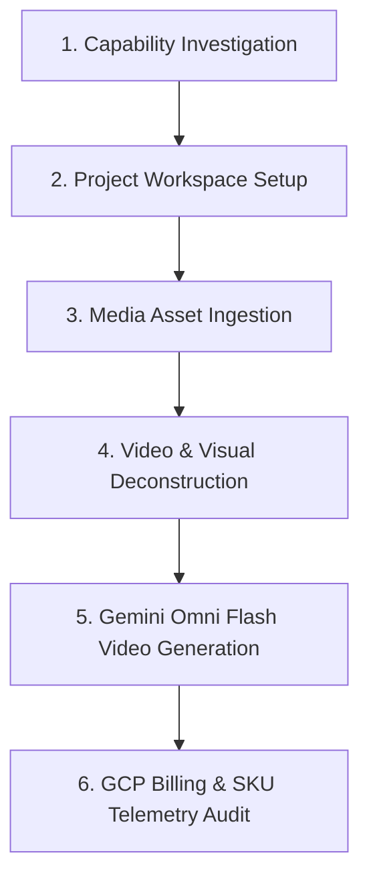

# Session Execution Log & Plan: UGC Video Project

## 1. Executive Summary

| Phase | Core Objective | Primary Deliverables / References | Outcome |
|---|---|---|---|
| **Investigation** | Assess OpenMontage support for UGC avatar videos | [`avatar-spokesperson.yaml`](file:///Users/thevinhnguyen/Documents/computer-science/projects/social-content/projects/OpenMontage/pipeline_defs/avatar-spokesperson.yaml), [`TalkingHead.tsx`](file:///Users/thevinhnguyen/Documents/computer-science/projects/social-content/projects/OpenMontage/remotion-composer/src/TalkingHead.tsx) | Confirmed native 9:16 support, TikTok captions, and multi-avatar tools. |
| **Workspace Init** | Setup canonical workspace under `projects/` | [`projects/ugc-video/`](file:///Users/thevinhnguyen/Documents/computer-science/projects/social-content/projects/ugc-video), [`project.json`](file:///Users/thevinhnguyen/Documents/computer-science/projects/social-content/projects/ugc-video/project.json) | Created canonical layout; symlinked to OpenMontage Backlot board. |
| **Asset Ingestion** | Acquire reference video & creator photo assets | [`local/In bao lì xì...mp4`](file:///Users/thevinhnguyen/Documents/computer-science/projects/social-content/projects/ugc-video/local/In%20bao%20l%C3%AC%20x%C3%AC%20gi%E1%BA%A5y%20m%E1%BB%B9%20thu%E1%BA%ADt%20%23locxuongin%20%20%23inbaolixi%20%20%23baolixidep%20_7577647857663102215.mp4), `assets/images/*.jpg` | Downloaded TikTok video via `yt-dlp`; unpacked creator photo turnaround pack. |
| **Vision Analysis** | Deconstruct reference video structure | `local/ref_start/`, `ref_audio.wav` | Identified 3-beat structure: hook sheet intro, table texture review, red envelope presentation. |
| **Video Generation** | Generate 10s UGC video using Google Omni Flash | [`ugc_test_10s.mp4`](file:///Users/thevinhnguyen/Documents/computer-science/projects/social-content/projects/ugc-video/renders/ugc_test_10s.mp4), [`generate_test_video.py`](file:///Users/thevinhnguyen/Documents/computer-science/projects/social-content/projects/ugc-video/local/generate_test_video.py) | Successfully generated 10.03s 720p H.264 video with native audio in 38.9s. |
| **Billing Audit** | Query authoritative GCP cost for run | GCP Billing Catalog Service `C7E2-9256-1C43` | Extracted exact SKU rates; total cost was **$1.0171 USD** (~25,885 VND). |

---

## 2. Inventory of Scripts & Commands Used

| Script / Command | Invocation Environment | Purpose & Action Performed | Key Outputs / Artifacts |
|---|---|---|---|
| **`init_project()`** | Python (`projects/OpenMontage/.venv`) | Initialized canonical OpenMontage workspace structure and metadata marker. | [`project.json`](file:///Users/thevinhnguyen/Documents/computer-science/projects/social-content/projects/ugc-video/project.json), `artifacts/`, `assets/`, `renders/` |
| **`ln -s`** | Shell (`zsh`) | Symlinked workspace to `projects/OpenMontage/projects/ugc-video` for Backlot UI discovery. | Symlink `projects/OpenMontage/projects/ugc-video` |
| **`yt-dlp`** | `uv run yt-dlp` | Downloaded target TikTok video at best MP4 quality with AAC audio. | [`local/In bao lì xì...mp4`](file:///Users/thevinhnguyen/Documents/computer-science/projects/social-content/projects/ugc-video/local/In%20bao%20l%C3%AC%20x%C3%AC%20gi%E1%BA%A5y%20m%E1%BB%B9%20thu%E1%BA%ADt%20%23locxuongin%20%20%23inbaolixi%20%20%23baolixidep%20_7577647857663102215.mp4) |
| **`unzip`** | System binary | Extracted Apple Live Photo bundle `Photos-1-001.zip` into `assets/images/`. | `IMG_0339` – `IMG_0342` (.HEIC & .MP4 pairs) |
| **`ffmpeg`** (Sampling) | System binary | Extracted 1fps reference frames and 16kHz mono audio from reference video. | `local/ref_start/frame_01-10.jpg`, `local/ref_audio.wav` |
| **`ffprobe`** | System binary | Verified stream parameters, codecs, duration, and resolution of media files. | Stream inspection metadata |
| **[`generate_test_video.py`](file:///Users/thevinhnguyen/Documents/computer-science/projects/social-content/projects/ugc-video/local/generate_test_video.py)** | Python (`google.genai` SDK) | Standalone Vertex AI Interactions API client executing video generation on `gemini-omni-flash-preview`. | [`renders/ugc_test_10s.mp4`](file:///Users/thevinhnguyen/Documents/computer-science/projects/social-content/projects/ugc-video/renders/ugc_test_10s.mp4), [`renders/ugc_test_10s.json`](file:///Users/thevinhnguyen/Documents/computer-science/projects/social-content/projects/ugc-video/renders/ugc_test_10s.json) |
| **GCP Billing Query** | Python / REST API | Authenticated with ADC token to query `cloudbilling.googleapis.com` for account details and SKU catalog. | Official SKU rates for video output and image/text input |

---

## 3. Video Generation Parameters & Telemetry

| Parameter | Configured Value | Notes / Description |
|---|---|---|
| **Model** | `gemini-omni-flash-preview` | Google DeepMind Gemini Omni Flash video generation model. |
| **Vertex AI Location** | `global` | Required location for Gemini Interactions API. |
| **Authentication** | ADC via `gcloud auth application-default` | Project: `gen-lang-client-0582170752`. |
| **Output Aspect Ratio** | `9:16` (720 × 1280) | Vertical UGC TikTok/Reels format at 24 fps. |
| **Output Target Duration** | `10s` (Actual: `10.03s`) | Specified via `response_format.duration`. |
| **Bound Reference 0** | [`assets/images/face.jpg`](file:///Users/thevinhnguyen/Documents/computer-science/projects/social-content/projects/ugc-video/assets/images/face.jpg) | Persona face anchor (`<IMAGE_REF_0>`). |
| **Bound Reference 1** | [`assets/images/front.jpg`](file:///Users/thevinhnguyen/Documents/computer-science/projects/social-content/projects/ugc-video/assets/images/front.jpg) | Creator outfit and framing anchor (`<IMAGE_REF_1>`). |
| **Interaction ID** | `ChBiNDc3MThhNWYwMDU2NWQ5EAgaAmM3KgRtYWlu` | Stored server-side (`store=true`) for conversational delta editing. |

---

## 4. Itemized Google Cloud Cost Breakdown

| SKU Description | Authoritative Rate | Consumption | Subtotal (USD) |
|---|---|---|---|
| **`Gemini Omni Flash Global Video Output`** | $0.000017500 / token | 57,920 tokens | $1.013600 |
| **`Gemini Omni Flash Global Image Input`** | $0.000001500 / token | 2,128 tokens | $0.003192 |
| **`Gemini Omni Flash Global Text Input`** | $0.000001500 / token | 214 tokens | $0.000321 |
| **Total Incurred Cost** | **Vertex AI (`C7E2-9256-1C43`)** | **60,671 tokens** | **$1.017113 USD (~25,885 VND)** |

---

## 5. Next Planned Actions

| Step | Action Item | Tool / Mechanism | Expected Outcome |
|---|---|---|---|
| 1 | **Conversational Delta Refinement** | `generate_test_video.py` with `previous_interaction_id` | Iteratively refine lighting, pacing, or dialogue without regenerating from scratch. |
| 2 | **Kinetic TikTok Captions** | Remotion `CaptionOverlay.tsx` | Burn word-by-word spring highlighted captions over the 9:16 canvas. |
| 3 | **Backlot Stage Review** | `python -m backlot open ugc-video` | Track project stage gates through OpenMontage's interactive board. |
