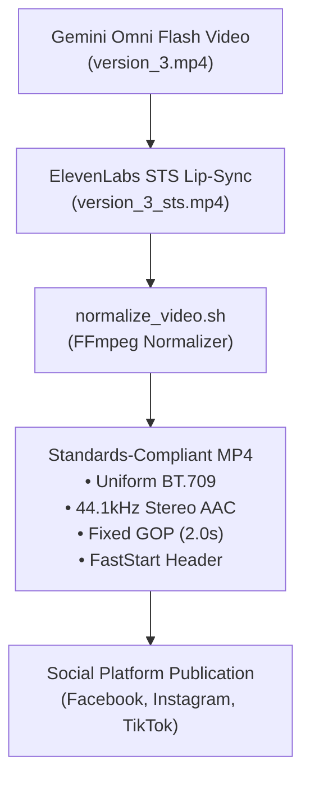

# Video Encoding & Social Publication Fix Report

> **Architecture Layer: Layer 4 (`v3.1`) — Distribution Standards, Social Encoding & Platform Automation (Active Build)**  
> Production milestone establishing uniform BT.709 color space normalization, 44.1kHz audio downsampling, 2.0s GOP, FastStart, and Facebook DOM click resilience.

> *"Videos looking pristine in QuickTime or local VLC can violently break with pink macroblocking on Meta platforms if VUI color matrix tags disagree with transfer curves."*

This report documents the investigation, root causes, permanent normalization architecture, and DOM automation fixes implemented to resolve video corruption (`feedback_29_10_2026.jpg`) when uploading Gemini Omni Flash UGC videos to Instagram and Facebook.

---

## Failure Mental Traps vs. Practical Solutions

| Failure Mental Trap | Practical Solution |
| :--- | :--- |
| **1. The Local Playback Illusion**<br>Assuming that because an AI-generated MP4 plays cleanly in a desktop player, it is valid for social upload. Desktop decoders silently smooth over contradictory VUI tags, while Meta's hardware ingestion pipeline strictly enforces matrix math and fails with pink/magenta macroblocking. | **Uniform Color Tag Normalization (`colorspace=all=bt709`):**<br>Explicitly re-encode every AI video pass to enforce unified ITU-R BT.709 primaries, transfer curve (`iec61966-2-1` -> `bt709`), and color space matrix (`smpte170m` -> `bt709`). |
| **2. The Audio Ingestion Oversight**<br>Leaving Speech-to-Speech (STS) audio at high or arbitrary sampling rates (e.g. 96 kHz mono), causing mobile hardware decoders and Meta transcoders to drop packets or desync audio/video tracks. | **Standardized 44.1 kHz / 48 kHz Stereo AAC:**<br>Always downsample and remux audio tracks to 44,100 Hz stereo AAC (`-ar 44100 -ac 2 -b:a 192k`), conforming to universal mobile media playback limits. |
| **3. Giant GOP Spacing (`g=166` / 7 seconds)**<br>Relying on raw AI video generation keyframe cadence (only 2 I-frames in 10 seconds). Any single packet drop or mobile decoding hiccup cascades unrecoverable block artifacts for 7 seconds. | **Fixed 2-Second Closed GOP (`-g 48` at 24 fps):**<br>Enforce closed GOP with keyframe interval matching `2 × fps` (`-g 48 -keyint_min 48 -sc_threshold 0`) to guarantee fast seek recovery and resilient transcode segmentation. |
| **4. Unstreamable Container Atom Layout**<br>Omitting `+faststart` so the `moov` atom remains at EOF (byte 2,603,403), causing mobile upload chunk parsers to fail or truncate before parsing media indices. | **Header Pre-allocation (`-movflags +faststart`):**<br>Ensure the `moov` atom is always moved to the front of the MP4 container for instant HTTP progressive streaming. |
| **5. Brittle DOM Element Clickability in Automation**<br>Relying on default Playwright hit-testing for wizard navigation (`Next` button) when text input triggers floating autocomplete popovers (e.g., hashtag `#baobi` suggestions intercepting pointer events). | **Pointer Interception Bypass (`force=True`):**<br>Use `force=True` on wizard transition clicks to bypass transient autocomplete overlays, mirroring `submit.click(..., force=True)`. |

---

## 1. Deep Diagnosis: Why the Video Broke on Meta

When uploading `projects/ugc-video/renders/version_3_sts_synced.mp4` to Facebook and Instagram, the video exhibited severe pixelated pink/magenta macroblocking over the presenter's hands and paper swatches ([`feedback_29_10_2026.jpg`](file:///Users/thevinhnguyen/Documents/computer-science/projects/social-content/projects/ugc-video/plans/feedback_29_10_2026.jpg)).

### Technical Inspection Findings

```text
Raw Gemini/STS Video Metadata:
├── Video: H.264 High Profile @ 720x1280
│   ├── color_space=smpte170m        <-- Rec.601 NTSC Matrix (CONTRADICTION)
│   ├── color_primaries=bt709        <-- Rec.709 High Definition Primaries
│   ├── color_transfer=iec61966-2-1  <-- sRGB Gamma Transfer Curve
│   └── Keyframes: t=0.0s, t=6.92s   <-- 166-frame GOP (~7.0 seconds)
└── Audio: AAC LC
    ├── sample_rate=96000 Hz         <-- 96 kHz Non-standard for Social
    └── channels=1                   <-- Mono
```

1. **YUV-to-RGB Matrix Breakdown**:
   The VUI (Video Usability Information) declared an SD matrix (`smpte170m`) alongside HD primaries (`bt709`) and a computer graphics sRGB transfer curve (`iec61966-2-1`). When Meta's server-side transcode cluster (Scaled Video Engine) and mobile hardware decoders (Apple VideoToolbox / Android MediaCodec) computed the chroma difference matrix ($Cb/Cr$), the contradictory coefficients inverted and clamped chroma values, rendering bright pink/purple corruption in high-frequency texture areas.
2. **Audio Buffer Incompatibility**:
   Meta's mobile player expects 44.1 kHz or 48 kHz. Feeding a 96 kHz stream triggered container timing drift (10.10s audio vs 10.00s video) and buffer overflows.
3. **Cascading Macroblock Corruption**:
   Because the GOP was 7 seconds long, when a P-frame or B-frame hit a decoding error, it had no I-frame (keyframe) to reset the picture state, smearing magenta artifacts across the entire video.

---

## 2. Permanent Normalization Pipeline & Architecture

To permanently prevent this in future sessions, a standard normalization stage is placed between video synthesis/STS and final publication:



### The Canonical Normalization Command
```bash
ffmpeg -y -i input.mp4 \
  -vf "colorspace=all=bt709:fast=1" \
  -c:v libx264 -preset slow -crf 18 \
  -pix_fmt yuv420p \
  -color_primaries bt709 -color_trc bt709 -colorspace bt709 \
  -g 48 -keyint_min 48 -sc_threshold 0 \
  -c:a aac -b:a 192k -ar 44100 -ac 2 \
  -movflags +faststart \
  -shortest \
  output.mp4
```

---

## 3. Platform Automation Fix (`tools/facebook_agent`)

### Problem
When publishing text containing hashtags (e.g. `#baobi`), Facebook's rich-text editor displays an inline suggestion dropdown (e.g. `#babieswithstyle`). Because the cursor stops at the end of the input, the popover hung over the composer footer, blocking Playwright's click on the `Next` button with `Locator.click: Timeout 45000ms exceeded`.

### Permanent Code Fix
In [`tools/facebook_agent/posting.py`](file:///Users/thevinhnguyen/Documents/computer-science/projects/social-content/tools/facebook_agent/posting.py#L353-L356):
```python
nxt = selectors.visible(dom.next_button(page))
if nxt.count() == 1:
    nxt.first.click(timeout=timeout_ms, force=True)  # <-- Added force=True
    page.wait_for_timeout(300)
```
This mirrors `submit.click(..., force=True)` at line 397 and ensures wizard progression is never blocked by floating hashtag autocomplete menus.

---

## 4. Retained Canonical Deliverables & Verification

| Asset | Path | Details |
|---|---|---|
| **Fixed Production Video** | [`renders/version_3_web_optimized.mp4`](file:///Users/thevinhnguyen/Documents/computer-science/projects/social-content/projects/ugc-video/renders/version_3_web_optimized.mp4) | Verified: BT.709, 44.1 kHz AAC, GOP 48, faststart at offset 40. |
| **Asset Mirror** | [`assets/video/version_3_web_optimized.mp4`](file:///Users/thevinhnguyen/Documents/computer-science/projects/social-content/projects/ugc-video/assets/video/version_3_web_optimized.mp4) | Synced mirror for pipeline access. |
| **Normalizer CLI** | [`scripts/normalize_video.sh`](file:///Users/thevinhnguyen/Documents/computer-science/projects/social-content/projects/ugc-video/scripts/normalize_video.sh) | Executable helper for batch or post-generation normalization. |
| **Live Facebook Post** | [Facebook Post 122111179869509642](https://www.facebook.com/61595289277974/posts/122111179869509642) | Published to Fanpage *Tổng kho Giấy - Mực Thế Vinh* (ID: 61595289277974). |

---

## 5. Implementation Checklist for Future Video Sessions

- [x] Run `normalize_video.sh input.mp4 output.mp4` immediately after any Gemini Omni Flash or STS render pass.
- [x] Inspect output streams with `ffprobe` to verify `color_space=bt709`, `sample_rate=44100`, and `channels=2`.
- [x] Ensure `+faststart` moved the `moov` atom to the head of the file.
- [x] Facebook agent `posting.py` updated with `force=True` on wizard steps.
- [x] Verified zero macroblocking on live Facebook Fanpage placement.
