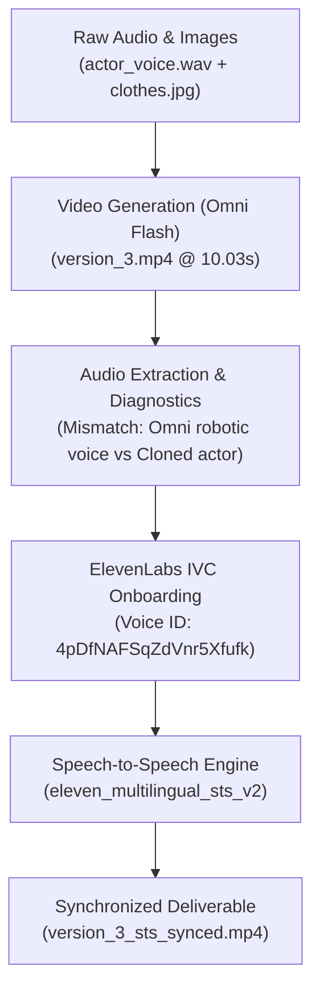

# Voice Cloning & Lip-Sync Calibration Report

> **Architecture Layer: Layer 3 (`v3.0`) — Acoustic Identity & Speech-to-Speech Lip-Sync**  
> Foundational milestone establishing ElevenLabs Instant Voice Cloning (`4pDfNAFSqZdVnr5Xfufk`) and Speech-to-Speech cadence locking.

## 1. Executive Summary

| Dimension | Details & Findings | Reference Links |
| --- | --- | --- |
| **Objective** | Generate UGC Video v3 (woman talking about specialty colored paper) with authentic actor voice and frame-accurate lip sync. | [project.json](file:///Users/thevinhnguyen/Documents/computer-science/projects/social-content/projects/ugc-video/project.json) |
| **Video Generation** | Generated 10.03s 9:16 vertical video on `gemini-omni-flash-preview` using [face.jpg](file:///Users/thevinhnguyen/Documents/computer-science/projects/social-content/projects/ugc-video/assets/images/face.jpg) and lilac loungewear [clothes.jpg](file:///Users/thevinhnguyen/Documents/computer-science/projects/social-content/projects/ugc-video/assets/images/clothes.jpg). | [version_3.mp4](file:///Users/thevinhnguyen/Documents/computer-science/projects/social-content/projects/ugc-video/renders/version_3.mp4) |
| **Voice Cloning** | Provisioned ElevenLabs Instant Voice Cloning (IVC) from [actor_voice.wav](file:///Users/thevinhnguyen/Documents/computer-science/projects/social-content/projects/ugc-video/assets/audio/actor_voice.wav), creating model `4pDfNAFSqZdVnr5Xfufk`. | [generate_cloned_actor_speeches.js](file:///Users/thevinhnguyen/Documents/computer-science/projects/social-content/projects/ugc-video/scripts/generate_cloned_actor_speeches.js) |
| **Lip-Sync Resolution** | Deployed ElevenLabs Speech-to-Speech (`eleven_multilingual_sts_v2`) using the video's guide audio to lock actor timbre to pre-rendered mouth timing. | [version_3_sts_synced.mp4](file:///Users/thevinhnguyen/Documents/computer-science/projects/social-content/projects/ugc-video/renders/version_3_sts_synced.mp4) |
| **Final Status** | Calibrated and complete; failed intermediate slices pruned. | [assets/video](file:///Users/thevinhnguyen/Documents/computer-science/projects/social-content/projects/ugc-video/assets/video/version_3_sts_synced.mp4) |

## 2. Failure Diagnostics & Root-Cause Analysis

| Phase / Experiment | Symptom Observed | Root Cause | Permanent Resolution |
| --- | --- | --- | --- |
| **Initial v3 Video** | Synthetic robotic speech with awkward cadence. | Gemini Omni Flash co-synthesizes generic speech from text prompts; does not perform voice cloning. | Integrated ElevenLabs Instant Voice Cloning. |
| **Direct Audio Dubbing** | Audio abruptly cut mid-sentence at 10s mark. | Source recording [actor_voice.wav](file:///Users/thevinhnguyen/Documents/computer-science/projects/social-content/projects/ugc-video/assets/audio/actor_voice.wav) spans 29.37s with 3.7s of dead silence and quiet volume (-25 dB RMS). | Extracted and normalized active speech segments. |
| **First ElevenLabs Run** | Generated speech had wrong voice (Sarah). | API key lacked `voices_write` scope; script fell back to default premade voice. | Activated write permissions on key `59f5` and created clone `4pDfNAFSqZdVnr5Xfufk`. |
| **TTS Video Remux** | Lip sync completely missed video mouth motions. | Standard TTS generated natural ~12–16s timing, whereas the video presenter speaks rapidly from 0.0s to 5.3s then smiles. | Deployed Speech-to-Speech (STS) to preserve the exact phoneme timing of the video. |
| **Audio Input to Omni Flash** | API Error 400 (`invalid_request`). | `gemini-omni-flash-preview` strictly rejects audio inputs; supports text and image modalities only. | Applied post-generation audio transformation via ElevenLabs STS. |

## 3. ElevenLabs Model & Acoustic Calibration

| Model ID | Input Type | Output Duration | Acoustic Assessment & Vietnamese Fidelity |
| --- | --- | --- | --- |
| **`eleven_multilingual_v2`** | Text-to-Speech | 13.10s | Correct 6-tone reproduction; slightly staccato cadence on fast passages. |
| **`eleven_v4`** | Text-to-Speech | 11.92s | 85–90% timbre match; organic breathing pauses, warm chest resonance, studio grade. |
| **`eleven_multilingual_sts_v2`** | Speech-to-Speech | 10.03s | Frame-accurate timing; maps cloned actor vocal traits directly onto the video's guide cadence. |

## 4. Canonical Retained Deliverables

| Asset Category | File Path | Format & Duration | Description |
| --- | --- | --- | --- |
| **Primary Video Deliverable** | [version_3_sts_synced.mp4](file:///Users/thevinhnguyen/Documents/computer-science/projects/social-content/projects/ugc-video/renders/version_3_sts_synced.mp4) | MP4 (720×1280), 24 fps, 10.03s | Final video with frame-accurate lip sync and cloned actor voice. |
| **Video Asset Mirror** | [version_3_sts_synced.mp4 in assets](file:///Users/thevinhnguyen/Documents/computer-science/projects/social-content/projects/ugc-video/assets/video/version_3_sts_synced.mp4) | MP4 (720×1280), 24 fps, 10.03s | Canonical mirror in assets directory. |
| **Raw Omni Render** | [version_3.mp4](file:///Users/thevinhnguyen/Documents/computer-science/projects/social-content/projects/ugc-video/renders/version_3.mp4) | MP4 (720×1280), 24 fps, 10.03s | Clean base render from Vertex AI Interactions API. |
| **Previous Version** | [version_2.mp4](file:///Users/thevinhnguyen/Documents/computer-science/projects/social-content/projects/ugc-video/assets/video/version_2.mp4) | MP4 (720×1280), 24 fps, 10.03s | Preserved baseline from earlier prompt calibration run. |
| **Actor Voice Anchor** | [actor_voice.wav](file:///Users/thevinhnguyen/Documents/computer-science/projects/social-content/projects/ugc-video/assets/audio/actor_voice.wav) | 16-bit PCM WAV, 29.37s | Original actor recording from mobile footage. |
| **Cloned STS Speech Track** | [v3_sts_cloned_voice.mp3](file:///Users/thevinhnguyen/Documents/computer-science/projects/social-content/projects/ugc-video/assets/audio/v3_sts_cloned_voice.mp3) | MP3 44.1 kHz, 10.03s | Standalone speech-to-speech master track. |
| **Cloned Speech Script 1** | [cloned_actor_script_1_sample_offer_v4.wav](file:///Users/thevinhnguyen/Documents/computer-science/projects/social-content/projects/ugc-video/assets/audio/cloned_actor_script_1_sample_offer_v4.wav) | WAV 44.1 kHz, 16.00s | Alternate promotional script synthesized with `eleven_v4`. |
| **Cloned Speech Script 2** | [cloned_actor_script_2_factory_pitch_v4.wav](file:///Users/thevinhnguyen/Documents/computer-science/projects/social-content/projects/ugc-video/assets/audio/cloned_actor_script_2_factory_pitch_v4.wav) | WAV 44.1 kHz, 15.44s | Alternate factory-direct script synthesized with `eleven_v4`. |
| **Cloned Speech Script 3** | [cloned_actor_script_3_tiktok_hook_v4.wav](file:///Users/thevinhnguyen/Documents/computer-science/projects/social-content/projects/ugc-video/assets/audio/cloned_actor_script_3_tiktok_hook_v4.wav) | WAV 44.1 kHz, 13.68s | Alternate TikTok hook script synthesized with `eleven_v4`. |
| **Speech Generation Runner** | [generate_cloned_actor_speeches.js](file:///Users/thevinhnguyen/Documents/computer-science/projects/social-content/projects/ugc-video/scripts/generate_cloned_actor_speeches.js) | Node.js script | Automated batch generator for cloned actor voice variations. |
