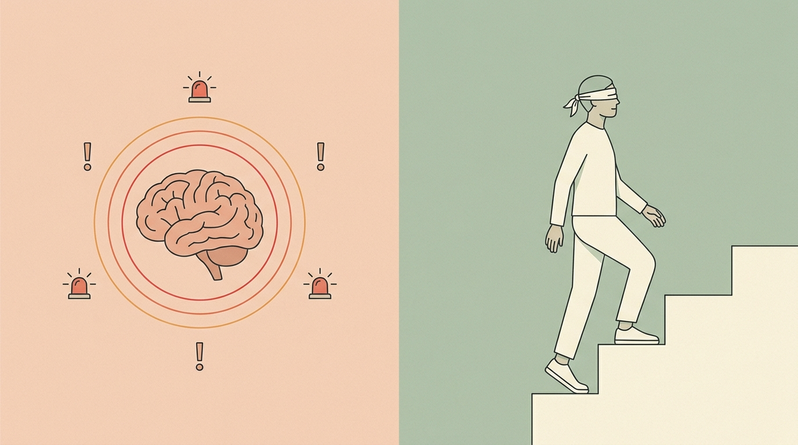

# Cái não suốt ngày doạ "sắp đâm cột điện"

Não người có một tật rất buồn cười: lúc nào nó cũng đi săn tín hiệu nguy hiểm. Xung quanh đang yên ổn, không có biến gì, nó vẫn tự đẻ ra vài kịch bản dở hơi để hù doạ Thân Tâm. Mình chưa kịp bước đi để xem thực tế ra sao, cái đầu đã hét lên: "Đi tiếp là đâm cột điện đấy." Mới nghe doạ thôi, chân đã vội quay xe.

Vậy làm sao để trị cái thói hay hù non này của bộ não?

Trước hết, công bằng mà nói thì não làm vậy cũng có lý do. Nó được thiết kế để giữ mạng cho mình sống sót ngay lúc này. Theo cơ chế tiến hoá, thà báo động nhầm 100 lần còn hơn bỏ sót 1 lần chết thật. Thế nên não lúc nào cũng ưu tiên an toàn ngắn hạn, cảnh giác cao độ với mọi thứ mới mẻ hay bất định.

Nhưng chính cơ chế sinh tồn đó lại thành con dao hai lưỡi. Vì quá mê sự an toàn trước mắt, não sẵn sàng hy sinh sự an toàn dài hạn của mình. Hãy nhìn con ếch ngồi trong nồi nước đang ấm dần. Nó sợ cảm giác bất an nếu nhảy ra ngoài khoảng không lạ lẫm, nên cứ nằm yên trong cái vùng "quen thuộc" đó cho tới lúc bị luộc chín. Bộ não của mình cũng hay chơi chiêu y hệt vậy: dồn hết năng lượng để ngăn mình làm những việc cần làm, chỉ vì lúc mới bắt đầu trông hơi lạ lẫm.

Muốn hết bị doạ, mình phải dùng Thân để chứng minh cho não thấy: thực ra não còn dốt lắm.

Mỗi ngày, mình tập đi lên xuống cầu thang ở chung cư, nhắm tịt mắt lại và tăng dần tốc độ. Lần nào cũng vậy, vừa bước vào khoảng tối sau mí mắt là cái não lại bắt đầu gào lên viễn cảnh sấp mặt, vấp ngã, hay lao đầu vào tường. Mình kệ nó, dồn sự chú ý xuống bước chân và tin vào cái Thân.

Điều thú vị nhất là leo kiểu đó rất tốn sức, nhưng cái mệt lại đến từ việc phải mặc cả liên tục với cơn hoảng loạn của cái đầu. Còn đôi chân và cơ thể thì sao? Khi mình nhắm mắt, cắt bớt kênh hình ảnh để não bớt vẽ vời, Thân tự nhiên được bật chế độ quan sát riêng của nó. Khớp gối, cổ chân, lòng bàn chân tự cảm nhận độ cao bậc thềm và khoảng cách xung quanh để giữ thăng bằng cực kỳ mượt, chẳng hề ngã như cái đầu vẫn doạ.

Càng đi cầu thang nhắm mắt nhiều ngày, cái não càng bớt hoảng loạn vì hết cớ để cãi. Còn cái Thân thì ngày một lanh lẹ, thông minh lên trông thấy.
