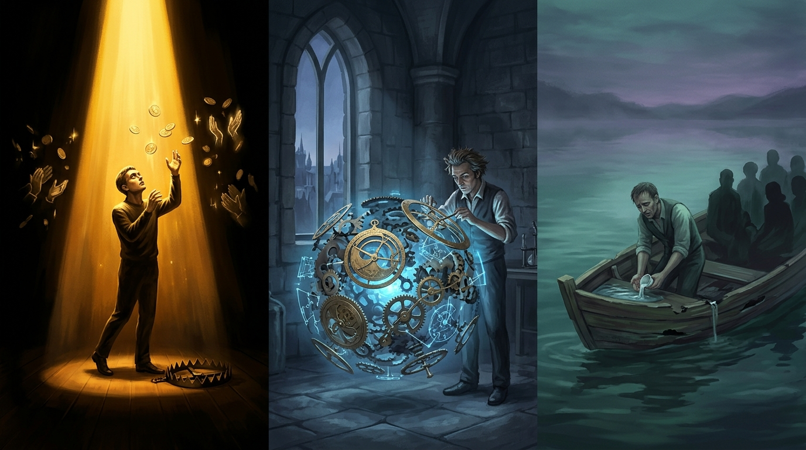
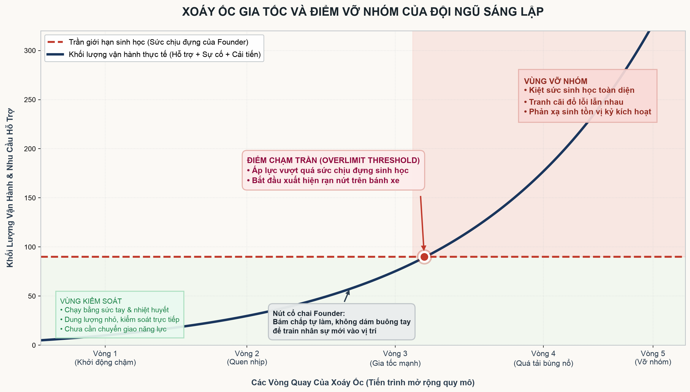

# Khi Không Còn Thấy Bế Tắc, Đôi Mắt Đã Mù Loà



Khi quan sát 20 nhà đào tạo AI enterprise và AI video hiện nay, bức tranh hiện ra là 20 ốc đảo cộng đồng hoàn toàn phân mảnh. Mỗi người thầy đóng cửa dạy học trò sử dụng một bộ công cụ riêng biệt. Ai cũng cố gắng tạo phễu thật rộng, kéo thật nhiều dân vào cộng đồng của mình, rồi chắt lọc ra nhóm tinh anh sẵn sàng trả tiền đều đặn hàng tháng.

Thế nhưng, sức người có hạn. Dù một chuyên gia có tài năng hay tận tụy đến đâu, giới hạn sinh học và năng lượng thần kinh cũng chỉ cho phép họ đồng hành sâu với vài chục người là chạm trần.

Hàng nghìn người còn lại bị bỏ rơi phía sau. Họ ngụp lặn giữa biển khoá học mới được cập nhật từng tuần, không theo kịp nhịp độ, đành tiếp tục chạy sang những lớp học khác để tìm kiếm cứu cánh. Có những người đã chi ra 20–30 triệu đồng, kinh qua 4–5 khóa học suốt một năm ròng rã, nhưng rốt cuộc vẫn không thể bám rễ vào đâu và đành ngậm ngùi bỏ cuộc hoàn toàn.

Mô hình đào tạo AI bán khóa học đóng gói hiện tại đã chạm tới giới hạn cấu trúc của nó: nó đang thất bại trong việc giải quyết bài toán của số đông. Thực tế này đòi hỏi một mô hình cộng sinh tiến bộ hơn phải ra đời.

---

### Mối Quan Hệ Tuần Hoàn: Sản Phẩm <> Cộng Đồng

Để một hệ sinh thái không biến thành cái bẫy lừa lọc hay một lớp học phù phiếm, điều đầu tiên phải thấu suốt là mối quan hệ tương hỗ hai chiều giữa **Sản phẩm/Dịch vụ** và **Cộng đồng**:

1. **Chiều đi:** Sản phẩm/Dịch vụ AI phải tạo ra lợi thế kiếm tiền thực tế (*unfair economic advantage*) cho toàn bộ cộng đồng. Nó không thể là những bài tập mẫu vô thưởng vô phạt, mà phải trực tiếp giải quyết chén cơm manh áo, tối ưu hóa năng suất hoặc mang về hợp đồng thật cho thành viên.
2. **Chiều về:** Khi cộng đồng thực sự tạo ra được dòng tiền nhờ sản phẩm, họ sẽ hoan hỉ và tự nguyện trả tiền đều đặn để nuôi dưỡng, duy trì và cùng đội ngũ sáng lập cải tiến sản phẩm ngày một mạnh hơn.

```text
       ┌────────────────────────────────────────────────────────┐
       │                                                        ▼
┌──────────────┐     Lợi thế kiếm tiền thực tế (Unfair ROI)     ┌──────────────┐
│  SẢN PHẨM /  ├───────────────────────────────────────────────►│   CỘNG ĐỒNG  │
│   DỊCH VỤ    │◄───────────────────────────────────────────────┤   NGƯỜI DÙNG │
└──────────────┘     Dòng tiền chi trả & Đóng góp cải tiến      └──────────────┘
       ▲                                                        │
       └────────────────────────────────────────────────────────┘
```

Nếu mối quan hệ tuần hoàn này bị đứt gãy ở bất kỳ mắt xích nào, cộng đồng sẽ lập tức tan rã. Lòng trung thành trong kinh doanh là thứ ảo tưởng; người dùng sẽ nhanh chóng bỏ đi ngay khi một sản phẩm thứ ba xuất hiện với khả năng giải quyết bài toán kiếm tiền của họ tốt hơn.

---

### Tam Giác Bám Chấp & Ba Chiếc Bẫy Triệt Tiêu

Vòng tuần hoàn nghe qua tưởng chừng đơn giản, nhưng tại sao hầu hết các nhóm sáng lập đều thất bại trong việc duy trì nó?

Bởi vì tâm lý con người luôn bị khuất phục trước **sự bám chấp quá đà vào một trụ cột**, mà vô tình triệt tiêu hai trụ cột sống còn còn lại.

```text
                   TRỤ 1: DÒNG TIỀN & THU HÚT
                 (Bẫy Hào Quang & Áp Lực Tiền)
                            ▲
                           ╱ ╲
                          ╱   ╲
                         ╱     ╲
                        ╱       ╲
                       ▼         ▼
  TRỤ 2: SẢN PHẨM & GIÁ TRỊ ◄───► TRỤ 3: GIỮ CHÂN & CHĂM SÓC
 (Bẫy Sĩ Diện & Cái Tôi Nghệ Sĩ)   (Bẫy Lòng Tốt & Người Cứu Thế)
```

Một guồng máy vận hành luôn được chống đỡ bởi ba trụ cột bình đẳng: **Thu hút dòng tiền – Hoàn thiện sản phẩm – Chăm sóc giữ dân**. Nhưng những chiếc bẫy nội tâm tinh vi sẽ kéo ngã từng người:

#### 1. Bẫy Áp Lực Dòng Tiền & Hào Quang

Dưới áp lực cơm áo gạo tiền đè nặng hoặc cơn say danh vọng từ những tràng pháo tay của mạng xã hội, người sáng lập rất dễ bị bám chấp tuyệt đối vào việc kéo dân.

- Họ điên cuồng làm phễu, giật tít, khoe khoang những con số triệu view để lùa thật nhiều người vào đàn.
- Khi dòng tiền hụt hơi, họ chuyển sang "thịt" chính số dân hiện tại bằng những gói upsell vô bổ, tận thu lòng tin của học viên.
- **Cái giá phải trả:** Bỏ bê chất lượng sản phẩm và bỏ rơi khâu hỗ trợ. Cộng đồng biến thành mỏ khoáng sản bị khai thác cạn kiệt, để lại sự phẫn nộ và tai tiếng.

#### 2. Bẫy Sĩ Diện Chuyên Gia

Dưới cái tôi của một kỹ sư hay sĩ diện của một chuyên gia công nghệ, người làm sản phẩm rất dễ sa đà vào việc tôn thờ sự hoàn hảo kỹ thuật xa rời thực tế.

- Họ say mê thử nghiệm những model AI phức tạp, viết ra những workflow đồ sộ chỉ để thỏa mãn cảm giác "mình làm được điều cao siêu", mà quên mất học viên và khách hàng ngoài kia chỉ cần một nút bấm đơn giản để ra tiền.
- Họ khinh thường những bài toán cơ bản của thị trường, cho rằng người học không đủ trình độ để hiểu sản phẩm của mình.
- **Cái giá phải trả:** Sản phẩm là một kiệt tác cô độc trong phòng thí nghiệm. Không ai dùng được, không ai trả tiền, và dự án chết yểu vì cạn kiệt nguồn sống.

#### 3. Bẫy Lý Tưởng Cao Đẹp

Dưới sự dẫn dắt của hội chứng người hùng cứu thế (*Savior complex*) hoặc lòng trắc ẩn thiếu trí tuệ, người quản lý rất dễ bị bám chấp tuyệt đối vào việc ôm đồm giữ dân.

- Họ sợ làm tổn thương người khác, không nỡ từ chối những đòi hỏi vô lý, sẵn sàng thức trắng đêm hỗ trợ 1-1 miễn phí cho từng người không theo kịp.
- Họ xây dựng một cộng đồng ấm cúng theo kiểu gia đình, cào bằng trách nhiệm và né tránh những kỷ luật tài chính sòng phẳng.
- **Cái giá phải trả:** Đội ngũ sáng lập kiệt quệ năng lượng và tinh thần. Con thuyền đang thủng đáy và chìm dần từng ngày vì không có doanh thu bù đắp chi phí, nhưng người thuyền trưởng vì quá mải miết tát nước cứu từng hành khách mà không hề hay biết tất cả sắp cùng nhau chìm nghỉm.

Có hàng nghìn chiếc bẫy bế tắc như thế giăng sẵn trên đường. Bi kịch nằm ở chỗ: **mắt thấy bẫy ở đó mà chân nó vẫn tự bước vào**. Con người hành động theo quán tính tâm lý sâu kín nhất của mình, và nếu không có năng lực tự giác ngộ để giật mình tỉnh giấc, sự mất cân bằng giữa ba trụ cột sẽ nghiền nát vòng tuần hoàn sống còn.

---

### Xoáy Ốc Gia Tốc & Thời Điểm Vỡ Nhóm

Một cỗ máy không phát nổ lúc nó đứng yên; nó vỡ tung khi bắt đầu chạy quá nhanh.

Thời điểm đầu khi sản phẩm ra mắt, việc khởi động vòng xoáy ốc đầu tiên diễn ra tương đối chậm chạp. Mọi thứ còn nằm trong tầm kiểm soát vì dung lượng nhỏ: vài chục khách hàng, vài lỗi kỹ thuật nhỏ, đội ngũ có thể dùng sức cơ bắp và lòng nhiệt huyết để khỏa lấp mọi lỗ hổng.

Nhưng sau khi lăn qua vài vòng, cỗ máy bắt đầu quen nhịp và tăng tốc:

- Hiệu ứng truyền miệng kéo nhiều dân vào hơn.
- Lượng người tăng vọt kéo theo nhu cầu hỗ trợ kỹ thuật và giải quyết khiếu nại bùng nổ theo cấp số nhân.
- Khách hàng mới mang theo vô số bài toán thực tế phức tạp, đòi hỏi sản phẩm phải liên tục cập nhật và cải tiến không ngừng nghỉ.



Đây là lúc sức chịu đựng của đội ngũ sáng lập chạm tới giới hạn sinh học:

- **Căn nguyên nghẽn mạch: Bám chấp vào tác nghiệp hiện tại.** Khi guồng quay tăng tốc, cái bẫy chết người nhất của người sáng lập là không dám buông tay. Họ bị cuốn phăng vào cơn lốc chữa cháy sự vụ hàng ngày, bám chấp tuyệt đối vào việc tự tay giải quyết mọi việc vì nghĩ không ai làm tốt bằng mình. Họ thiếu dũng khí để **cắt giảm sự bám chấp vào công việc hiện tại**, không dám chậm lại một nhịp để **train nhân sự mới vào vị trí**. Không có người mới đủ lực để chia tải, chính những người sáng lập trở thành chiếc nút cổ chai siết nghẹt cả cỗ máy.
- Các vết rạn nứt bắt đầu xuất hiện li ti trên vành bánh xe: Những đêm mất ngủ kéo dài, sự kiệt sức gặm nhấm tinh thần, thất bại và phàn nàn diễn ra với tần suất dày đặc hơn bao giờ hết.
- Những cuộc họp chiến lược biến thành những buổi tranh cãi gay gắt và đổ lỗi lẫn nhau: người làm sản phẩm trách người bán hàng hứa hão, người làm cộng đồng trách kỹ thuật chậm chạp, người gánh dòng tiền trách tất cả thiếu thực tế.

Khi các vấn đề xuất hiện dày đặc vượt quá năng lực xử lý của hệ thống cũ, một cơ chế tâm lý nguyên thủy sẽ lập tức được kích hoạt: **phản xạ sinh tồn ưu tiên bản thân**.

Mỗi thành viên bắt đầu vô thức dựng lên bức tường phòng vệ để bảo toàn năng lượng, tiền bạc và thể diện của riêng mình. Sự tin tưởng bay màu, liên minh tan rã.

**Và đó chính là thời điểm vỡ nhóm.**

---

### Quy Luật Bế Tắc & Đôi Mắt Mù Loà

Một khi bánh xe đã chấp nhận lăn bánh trên thương trường, bế tắc sẽ liên tục xuất hiện. Đó không phải là tai nạn hay xui rủi; đó là thuộc tính tự nhiên của sự vận động.

Giải quyết xong bế tắc về dòng tiền, bế tắc về quy mô hỗ trợ sẽ ập tới. Giải quyết xong bế tắc về hỗ trợ, bế tắc về kiến trúc sản phẩm sẽ đón đầu. Bản lĩnh của một đội ngũ không nằm ở việc mơ mộng về một ngày mai bình yên không sóng gió, mà nằm ở **năng lực cả nhóm phải liên tục tự giác ngộ**.

Giác ngộ là năng lực lạnh lùng nhìn thẳng vào sự thật:

- Dám nhận ra mình đang bị kẹt vào cái bẫy nào trong ba trụ cột.
- Dám dẹp bỏ sĩ diện chuyên gia để sửa sản phẩm theo nhu cầu thô ráp của đời thực.
- Dám cắt giảm sự bám chấp vào tác nghiệp hiện tại, kiên nhẫn lùi lại để train nhân sự mới vào guồng máy.
- Dám cắt lỗ cái Tôi, tái cấu trúc đội hình, và thừa nhận mô hình cũ đã không còn chịu nổi áp lực của vòng xoay mới.

Và bài học đắt giá nhất nằm ở một nghịch lý sâu cay:

> **Lúc nào mà ta không còn thấy bế tắc, nghĩa là đôi mắt đã mù loà.**

Khi một founder hay một đội ngũ tự mãn cảm thấy mọi thứ đang diễn ra hoàn hảo, trơn tru, không còn một vết gợn nào cần sửa chữa—đó không phải là dấu hiệu của sự thành công viên mãn. Đó là dấu hiệu cho thấy toàn bộ hệ thống đã bị che mờ bởi những điểm mù chết người. Bạn không nhìn thấy bế tắc vì bạn đã mất đi độ nhạy với thực tại.

Và chính trong giây phút bình yên giả tạo ấy, một cú đánh bất ngờ từ thị trường sẽ giáng xuống, đủ tàn khốc để hất tung cả cỗ xe ra khỏi đường ray vĩnh viễn.
