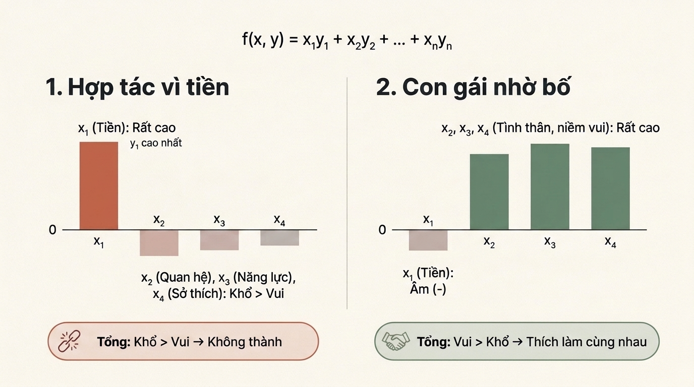
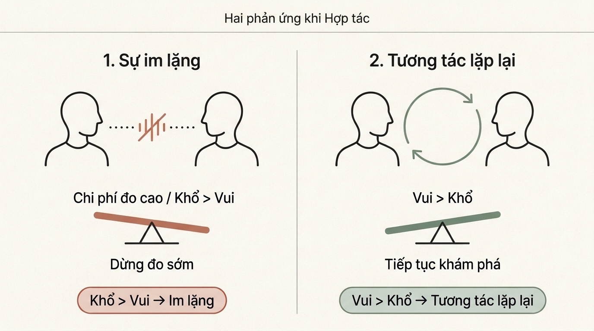

# Tăng đoàn #2: Thách thức Hợp tác

Sau khi thử nghiệm vài kết nối giữa các vị A-la-hán, phản ứng trả về khá đa dạng. Có trường hợp thành đấu pháp. Có trường hợp lúc gặp rất vui nhưng lúc về lại im. Có trường hợp thì tích cực khám phá thêm. Qua việc đặt những thử nghiệm đó cạnh nhau, mình dần nhận ra hình hài và giới hạn của sự Hợp tác.

## Phương trình của một cuộc hợp tác bền vững

Mình hình dung sự Hợp tác là tổng hợp của các yếu tố lợi ích cơ bản. Khi cộng dồn lại, kết quả trả về phải nhiều vui hơn ban đầu thì cuộc hợp tác mới bền vững được. Vì ngôn từ khó diễn đạt hết cấu trúc nhiều chiều này, mình mượn toán học làm một ngôn ngữ bao quát hơn để mô tả:

$$f(x, y) = x_1 y_1 + x_2 y_2 + \dots + x_n y_n$$

Trong đó, $x$ là yếu tố lợi ích, còn $y$ là mức độ quan trọng của yếu tố đó.

Lấy ví dụ một cuộc hợp tác kinh doanh vì tiền. Yếu tố $x_1$ là số tiền kiếm được, và nó mang mức độ quan trọng $y_1$ cao nhất. Bên cạnh đó vẫn tồn tại hàng loạt yếu tố khác: $x_2$ là mối quan hệ, $x_3$ là năng lực, $x_4$ là sở thích, và nhiều biến số nữa. Dù $x_1$ rất cao, nếu mọi yếu tố còn lại đều mang tới nhiều khổ hơn vui, phép cộng dồn toàn bộ vẫn trả về kết quả khổ nhiều hơn vui. Vậy là cuộc hợp tác đó không thành.

Ngược lại, hãy nhìn vào trường hợp một người con gái nhờ bố giúp việc. Ở đây, $x_1$ là số tiền kiếm được mang giá trị âm. Thế nhưng mọi yếu tố khác lại cao vượt trội, nên khi cộng dồn toàn bộ, phần vui vẫn nhiều hơn phần khổ. Kết quả là cả hai vẫn thích làm cùng nhau.

Hiểu được cấu trúc cộng dồn này mở ra một cách thiết kế lại lời đề nghị hợp tác. Khi nhìn rõ từng biến $x$ và trọng số $y$, ta có thể chủ động phối lại các yếu tố: đắp thêm một giá trị cộng thêm để bù vào phần đang yếu, hoặc gọi tên đúng một giá trị ẩn vốn mang mức độ quan trọng $y$ cao hơn hẳn trong mắt đối tác. Lúc đó, tổng phương trình có thể đảo chiều từ khổ sang vui mà không cần dồn hết áp lực vào một biến $x_1$ duy nhất.

## Ba con mắt đo lường và cái giá của phép đo

Công thức nhìn qua thì gọn, nhưng cái khó thực sự nằm ở việc xác định đúng yếu tố lợi ích $x$ và đo được mức độ quan trọng $y$ một cách hiệu quả, chính xác.

Muốn đo được, ta phải dùng đúng thước: **Thân đo Thân, Tâm đo Tâm, Trí đo Trí**. Cả ba con mắt Thân, Tâm, Trí đều phải sáng rõ. Phải đo được nhu cầu và năng lực của đối tác, đo được nhu cầu và năng lực của chính ta, rồi cộng cả hai lại xem niềm vui cuối cùng có nhiều hơn không.

Khó ở chỗ thước đo Thân, Tâm, Trí giữa các thế hệ, nền văn hoá và nghề nghiệp lại lệch nhau rất xa. Thế hệ nhiều tuổi thường mang hệ quy chiếu khác hẳn người trẻ: một hành động vốn rất bình thường trong giới trẻ, qua con mắt của thế hệ lớn tuổi lại dễ bị đọc thành sự yếu đuối. Tương tự, điều được xem là thẳng thắn ở nền văn hoá này có thể bị coi là thiếu tôn trọng ở nền văn hoá khác, hay thứ mà người làm kỹ thuật thấy hiển nhiên lại hoàn toàn khác với mối bận tâm của người làm kinh doanh. Khi mỗi bên cầm một cây thước khác nhau để định giá $x$ và trọng số $y$, phép đo rất dễ sai lệch ngay từ đầu.

Ngay ở bước này đã nảy sinh một giới hạn rất thực tế: chi phí đo. Nếu chi phí bỏ ra để đo quá cao so với tiềm năng lợi ích vui nhận về, việc đo sẽ bị dừng sớm chứ chưa nói tới chuyện hợp tác. Nhìn từ góc độ này, phản ứng của con người sau mỗi lần tiếp xúc trở nên rất rõ ràng. Sự im lặng là phản ứng tự nhiên khi phép cộng trả về khổ nhiều hơn vui. Còn sự tương tác lặp lại là phản ứng khi kết quả trả về vui nhiều hơn khổ.

## Từ hỗn loạn ban đầu tới cấu hình 3.000 năm

Đánh giá ban đầu thực chất chỉ là một phép ước lượng niềm vui có thể nhận về. Qua nhiều lần tương tác qua lại, các tham số trong phương trình Hợp tác tự điều chỉnh, đi từ trạng thái ban đầu rất loạn cho tới khi ổn định dần.

Đức Phật đã tìm ra được một cấu hình nào đó khiến cho phương trình Hợp tác trở nên rất bền vững qua 3.000 năm. Cấu hình ấy ẩn trong Tứ Diệu Đế, và đòi hỏi cả ba con mắt Thân, Tâm, Trí phải thật sáng để thấy lại.
