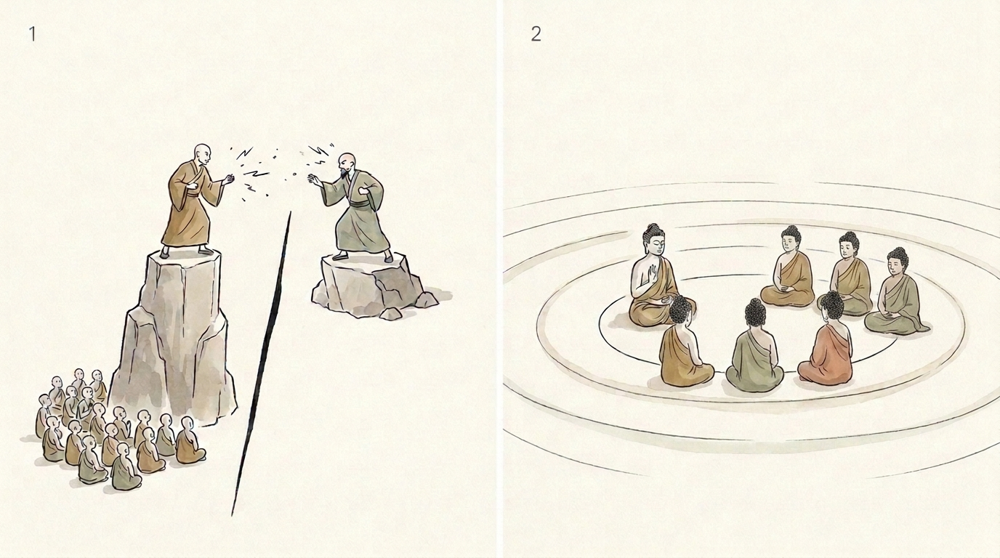

# Tăng đoàn là mô hình xử lý bế tắc

Kinh điển ghi nhận tăng đoàn của Đức Phật có 1.250 vị A-la-hán. Chỉ riêng một vị A-la-hán đã có thần thông quảng đại và hàng nghìn đệ tử đi theo. Vậy làm sao Đức Phật có thể hợp tác và quy tụ lâu dài với cả 1.250 vị như thế? Rất nhiều bậc thầy cố gắng trả lời câu hỏi này: làm sao để xây được một hệ thống trường tồn qua 3.000 năm, rồi mở rộng ra tiếp hàng chục nghìn vị A-la-hán khác? Lý do tồn tại thực sự của tăng đoàn là gì?

## Lối đọc mòn từ kinh điển

Trước khi Đức Phật xuất hiện, mỗi vị A-la-hán phân chia rõ ràng cõi riêng. Nước sông không phạm nước giếng, hễ xâm phạm là chiến đấu, hàng nghìn pháp môn cứ thế chia cắt khắp Ấn Độ cổ.

Theo cách kể quen thuộc trong kinh điển, Đức Phật xuất hiện, thể hiện năng lực vượt trội hơn các vị A-la-hán kia, chỉ ra chỗ còn kém của họ, và thế là họ quy phục theo Ngài. Nhiều bậc thầy đời sau đọc đoạn đó rồi học theo y như vậy. Nhưng qua những chuyến hành hương và quan sát thực tế, phản ứng đầu tiên của các bậc thầy khi gặp người ngang tầm luôn là đấu pháp để đè đối phương xuống. Kết quả chỉ sinh ra tâm sân giận hoặc sợ hãi ngược lại. Xung quanh họ cũng tụ họp được khoảng nghìn đệ tử, nhưng toàn những người yếu thế hơn họ.

Sự khác biệt nằm ngay ở cấu trúc cộng đồng. Ngay từ buổi đầu thu phục 5 anh em Kiều-trần-như, tăng đoàn của Đức Phật đã có thêm 5 vị A-la-hán cùng đứng chung một hàng. Còn cộng đồng của những bậc thầy đi theo lối đấu pháp kia lại chỉ có duy nhất một mình họ là A-la-hán. Khi nhiều người cùng làm theo một công thức đọc từ kinh sách mà kết quả lại hoàn toàn trái ngược, rất có thể Đức Phật đã làm một cách khác hẳn.

## Ai cũng thấy bế tắc của nhau, nhưng mấy ai dám giúp

Con người sinh ra vốn có xu hướng rơi vào bế tắc. Vượt qua được một bế tắc này lại đụng ngay một bế tắc khác. Ngay cả các bậc thầy cũng đang phải tự xoay xở giải quyết những bế tắc của riêng họ. Nghịch lý ở chỗ, dù đang loay hoay với phần việc bên trong của mình, họ vẫn phải gồng lên bảo vệ và mở rộng cõi riêng trước các vị khác, vì đó là nguồn tài nguyên để họ tồn tại.

Ở tầng nhận thức của một vị thầy, bất kỳ vị nào cũng có khả năng nhìn thấy bế tắc của vị khác. Nhưng giữa rất nhiều người nhìn thấy, Đức Phật chọn bước tới và giúp.

Giúp một người đang bế tắc rất khó. Nó đòi hỏi người giúp phải tự đối diện với ba nỗi sợ lớn ngay trong tâm mình: liệu mình có đủ năng lực để giúp thật sự không, tâm sân của mình có chịu nổi sự bế tắc và ngoan cố của người kia không, và nếu giúp được rồi thì tâm tham của mình có trỗi dậy để lợi dụng họ hay không. Phần lớn chọn cách an toàn là giữ cõi riêng, hoặc biến sự bế tắc của người khác thành cái cớ để chứng minh mình cao hơn.

Đức Phật lại chọn xây ra một mô hình xử lý bế tắc. Nguyên lý của tăng đoàn khá giản dị: tích lũy đủ số lượng A-la-hán, và mỗi vị đủ nhẫn nại để ngồi xuống giải quyết vấn đề chung của nhau. Khi đủ lượng người như vậy cùng kiên trì với nhau, chắc chắn đến một thời điểm nào đó, bế tắc của toàn bộ tập thể sẽ được tháo gỡ.

## Sống chung với hàng nghìn bế tắc và học cách cười

Hiện nay vẫn có một số ít bậc thầy đang thử đi theo con đường này, nhưng để hiện thực hóa được nó thì khó vô cùng. Thách thức lớn nhất nằm ở câu hỏi: tâm mình có đủ bao dung để cảm thấy thoải mái với bế tắc của chính mình và bế tắc của nhiều người khác cùng lúc hay không?

Thực tế là đời người chẳng bao giờ hết bế tắc. Giải xong bài toán này lại mở ra bài toán khác. Đằng nào cũng phải sống chung với hàng nghìn bế tắc cả đời, thì tốt nhất là cười thôi 😄

Nhà văn Nam Cao từng viết trong *Lão Hạc*:

> "Một người đau chân có lúc nào quên được cái chân đau của mình để nghĩ đến một cái gì khác đâu? Khi người ta khổ quá thì người ta chẳng còn nghĩ gì đến ai được nữa. Cái bản tính tốt của người ta bị những nỗi lo lắng, buồn đau, ích kỷ che lấp mất."

Khi mang một cái tâm không chịu nổi bế tắc, ta rất dễ phản ứng gay gắt trước sự bộc lộ bế tắc của người bên cạnh: chê họ dốt, vội vàng bày ra giải pháp bắt họ làm theo, hoặc thẳng tay nghỉ chơi với họ. Trong khi quay lại nhìn mình, chính mình cũng đang loay hoay, vì bế tắc của bản thân có tự giải nổi đâu, mà thái độ đó cũng chẳng thu hút được ai đủ kiên nhẫn ở lại giải hộ mình.

Cuối cùng, hy vọng thực tế nhất vẫn là tìm được đường gia nhập vào một tăng đoàn, nơi có đủ số lượng A-la-hán đủ bao dung với cái chân đau của nhau, để bế tắc chung có một ngày được giải.
